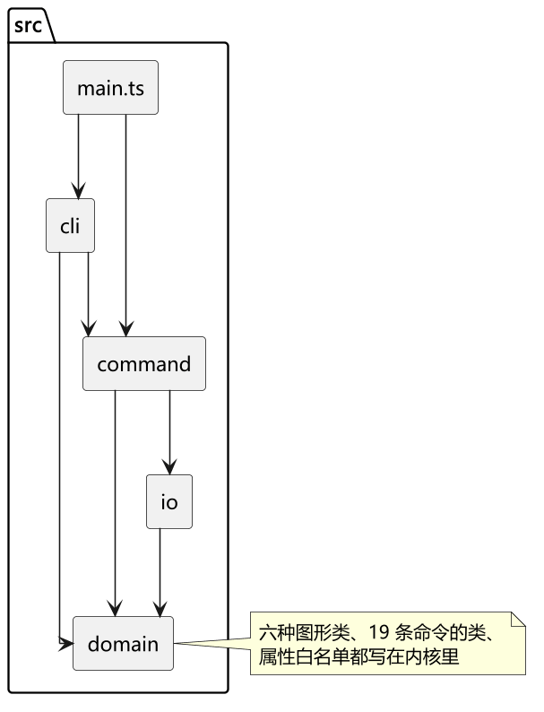
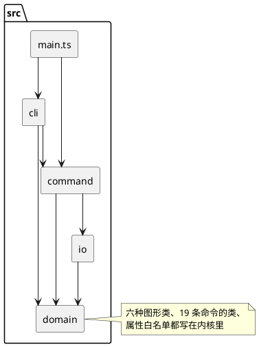
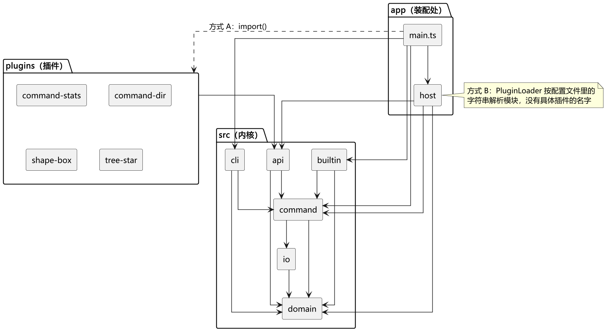
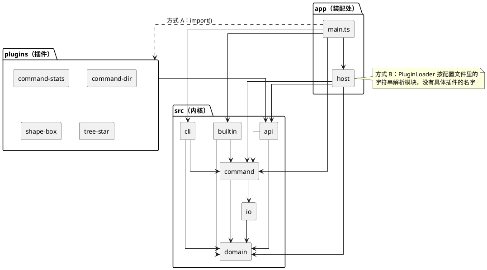
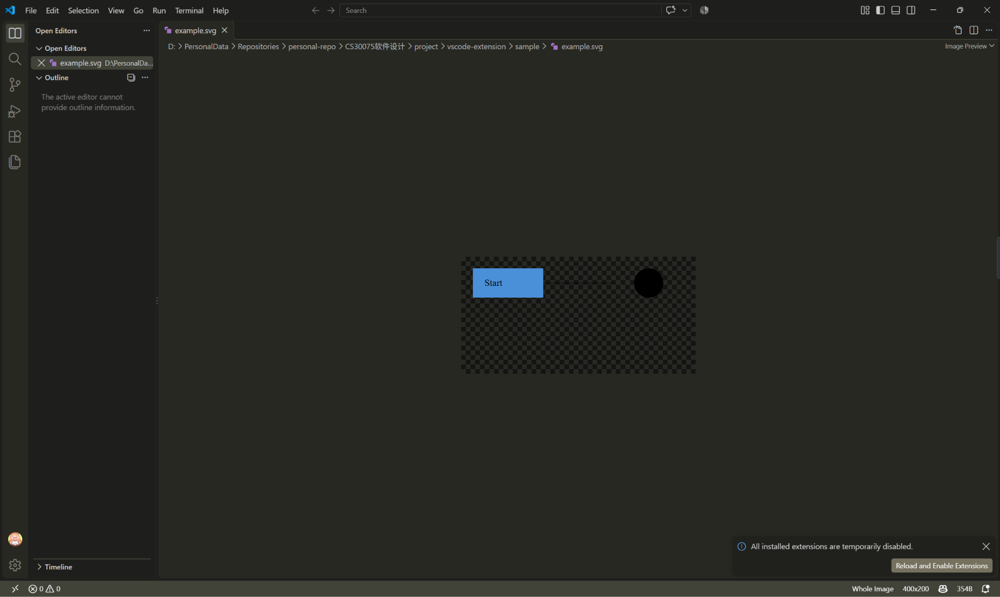
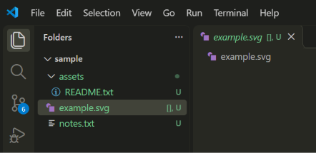
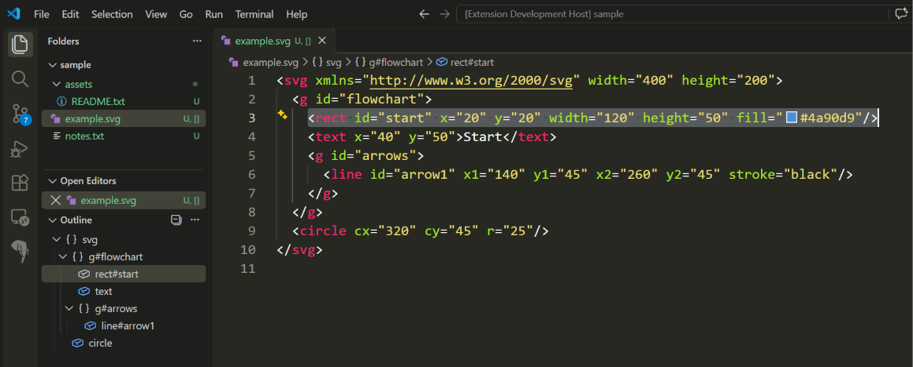

# SVG 编辑器 Phase 2 设计文档

本文档对应题目 `doc/pj1-phase2/phase_cli_2.md`。Phase 1 的设计文档在 [doc/pj1-phase1/README.md](pj1-phase1/README.md)。题目同时用到 `doc/` 和 `docs/metrics/`：前者放文档和会话脚本，后者只放脚本生成的度量结果。

第 1 节是写代码之前定的方案，已按最终实现更新，改动见 1.6 修订记录。

## 1 架构方案

### 1.1 三类代码，三个顶层目录

差异判据和度量都按"内核 / 装配处 / 插件"三类来算，所以三类代码各占一个顶层目录，`git diff` 和行数统计直接按目录做。

```text
src/        内核。接入新插件时，这里的文件一个都不改。
  domain/     图形类层次、SvgDocument、备忘录，以及 ShapeProvider、AttributeHandler 等扩展点接口
  command/    命令基类、执行器、Workspace、内置命令类、TreeRenderer，以及 CommandProvider、TreeDecorator 等扩展点接口
  io/         SvgReader（按 ShapeProvider 查找类型）、SvgWriter
  cli/        Repl，以及把命令注册表接到 commander 上的 CliProgram
  builtin/    六种内置图形和 Phase 1 的内置命令表，它们也通过注册机制装配
  api/        Plugin 与 PluginContext；index.ts 是插件唯一可以导入的入口（@svgframe/api）
app/        装配处。
  main.ts     组合根：先装内置能力，再按方式 A 的代码清单或方式 B 的配置文件装插件
  host/       PluginHost、StagedContext、PluginManifest、PluginConfig、PluginLoader
plugins/    插件。每个插件是一个 bun workspace 包，package.json 里有 main、exports 和 contributes。
  command-stats/  command-dir/  shape-box/  tree-star/
vscode-extension/   第一部分的 VSCode 扩展，单独的包和 tsconfig，度量时单独列出
plugins.config.json 方式 B 的配置文件
scripts/            度量脚本和基线脚本
```

依赖方向：插件的源码只导入 `@svgframe/api`、`node:*` 和自己的文件。`app` 依赖内核和 `node:*`。内核不依赖 `app`、插件和测试代码。oxlint 的 `no-restricted-imports` 为每个模块写一条白名单，`test/lint/ModuleRules.test.ts` 逐个检查允许和禁止的导入。

### 1.2 扩展点清单

四个扩展点的接口都在内核里，插件只通过 `@svgframe/api` 看到它们。内核从注册表（`Catalog` 和 `Extensions` 中的 `Registry`）按名字查找实现，代码里没有任何具体图形、命令或插件的列表。

| 扩展点                         | 内核侧接口                                                                                          | 内核调用它的位置                                                      | 本阶段的实现                                                      | 不装可选插件时的行为                                                                                                                    | 违反契约时的报错                                                                                                                                                                       |
| ------------------------------ | --------------------------------------------------------------------------------------------------- | --------------------------------------------------------------------- | ----------------------------------------------------------------- | --------------------------------------------------------------------------------------------------------------------------------------- | -------------------------------------------------------------------------------------------------------------------------------------------------------------------------------------- |
| `ShapeProvider`                | `src/domain/ShapeProvider.ts`：`{ type; create(id): Shape }`                                        | `SvgDocument.create`，读入时的 `Catalog.readShape`，`help` 的类型列表 | 六种内置图形（`src/builtin/BuiltinShapes.ts`）、`box`             | `create box` 报 `unknown shape type: box (is the plugin loaded?)`；读入 `<g data-kind="box">` 时按普通 `g` 处理，保存时保留 `data-kind` | 类型名重复：`duplicate registration: shapes/<name>`；`data-kind` 的类型创建出的标签与元素不同，就按标签查找                                                                            |
| `Command`（`CommandProvider`） | `src/command/CommandProvider.ts`：`{ name; syntax; description; create(args, context) }`            | `CliProgram.run` 按命令名查注册表                                     | 19 条内置命令（`src/builtin/BuiltinCommands.ts`）、`stats`、`dir` | `error: unknown command: <name>`，`help` 里也没有这条命令                                                                               | 命令名重复：`duplicate registration: commands/<name>`；命令名含空格或以 `-` 开头时拒绝注册；命令抛出非 `EditorError` 的异常时显示 `error: internal: …`                                 |
| `TreeDecorator`                | `src/command/TreeDecorator.ts`：`{ name; label(shape) }`                                            | `TreeRenderer` 通过 `DecoratingLabel` 链调用                          | `modified-star`、`box-type-label`                                 | 树的输出与 Phase 1 逐字节相同                                                                                                           | 抛错时 `tree` 报 `tree decorator failed: <name> (<reason>)`                                                                                                                            |
| `AttributeHandler`             | `src/domain/AttributeHandler.ts`：`{ name; handles(shape, attr); apply(shape, attr, value, edit) }` | `SvgDocument.set`                                                     | `box-attributes`                                                  | 内置的 `StandardAttributes` 按 Phase 1 的白名单处理，未知属性报 `unknown attribute: <attr>`                                             | 两个以上处理器同时负责：在任何写入之前报 `conflicting attribute handlers for <attr> on <shape>: <names>`；处理器抛错：回滚已写入的值，报 `attribute handler failed: <name> (<reason>)` |

另有一个辅助扩展点 `WorkspaceObserver`（`src/command/WorkspaceObserver.ts`）。`init`、`read` 和 `save` 成功以后，`Workspace` 依次通知每个观察者。`modified-star` 用它记下保存时的状态。一个观察者抛错时，命令仍然成功，输出多一行 `error: workspace observer failed: <name> (<reason>)`，其他观察者照常收到通知。清单里它的类别名是 `observers`。

每个扩展点都有"注册、调用、缺省"三类测试，测试名以 `register:`、`invoke:`、`default:` 开头：

| 扩展点              | 测试文件                                      |
| ------------------- | --------------------------------------------- |
| `ShapeProvider`     | `test/domain/Catalog.test.ts`                 |
| `Command`           | `test/cli/CliProgram.test.ts`（最后三个测试） |
| `TreeDecorator`     | `test/command/TreeDecorators.test.ts`         |
| `AttributeHandler`  | `test/domain/AttributeHandlers.test.ts`       |
| `WorkspaceObserver` | `test/command/WorkspaceObservers.test.ts`     |

### 1.3 两种装配方式与配置文件格式

两种方式最后都调用同一个 `PluginHost.installAll(sources)`（`app/host/PluginHost.ts`），所以经过同一条注册、校验和回滚路径。一个来源（`PluginSource`）只有两个函数：`manifest()` 导入插件的 `package.json`，`load()` 导入插件的入口模块。

- 方式 A，代码装配：`app/main.ts` 里的 `shipped` 数组列出每个插件的来源，例如 `load: () => import('@svgframe/plugin-shape-box')`。没有命令行参数时用这个列表。只有走方式 A 时这些函数才会被调用，所以导入失败、构造失败和 `activate` 失败都落在同一个回滚边界之内。
- 方式 B，配置装配：`bun run cli --config plugins.config.json`。`PluginConfig` 读配置文件，`PluginLoader` 用 `createRequire(配置文件路径)` 解析模块名。包名按 Node 的解析规则查找，以 `./` 或 `../` 开头的路径相对于配置文件所在的目录。加载器里没有任何具体插件的名字。`test/host/PluginLoader.test.ts` 用两种写法各加载一个插件。
- `--no-plugins`：只装内置能力，用来和 Phase 1（tag `final`）的输出逐字节对照。

配置文件的格式：

```json
{
  "plugins": [
    { "module": "@svgframe/plugin-stats" },
    { "module": "@svgframe/plugin-dir" },
    { "module": "@svgframe/plugin-shape-box", "options": { "fill": "#4a90d9" } },
    { "module": "./plugins/tree-star", "enabled": true }
  ]
}
```

| 字段      | 类型                    | 含义                                                                                              |
| --------- | ----------------------- | ------------------------------------------------------------------------------------------------- |
| `plugins` | 数组，必填              | 按数组顺序加载。注册顺序也决定 `help` 中命令和类型的顺序，以及树标签的顺序                        |
| `module`  | 非空字符串，必填        | 包名，或相对于配置文件目录的路径                                                                  |
| `enabled` | 布尔值，可选，默认 true | 为 `false` 时完全跳过这一项，连模块都不导入                                                       |
| `options` | 对象，可选，默认 `{}`   | 原样放进 `PluginContext.options`，插件在 `activate` 里读取。例如 `box` 用 `fill` 设定新框体的颜色 |

配置文件的语法或结构不对时，打印 `error: invalid plugin config: <路径> (<原因>)`，然后只带内置能力启动。只要有一项不对，整个文件都不使用，不会先装前面的几项。

插件的清单就是它的 `package.json`。`exports["."]` 必须是一个不带条件的路径，`exports` 里还要导出 `./package.json`。`contributes` 列出插件的全部注册名，分为 `shapes`、`commands`、`decorators`、`attributes`、`observers` 五类，缺省为空。例如 `plugins/shape-box/package.json`：

```json
{
  "name": "@svgframe/plugin-shape-box",
  "main": "./src/BoxPlugin.ts",
  "exports": { ".": "./src/BoxPlugin.ts", "./package.json": "./package.json" },
  "contributes": {
    "shapes": ["box"],
    "attributes": ["box-attributes"],
    "decorators": ["box-type-label"]
  }
}
```

安装一个插件的失败与输出（每一行都以 `error:` 开头，编辑器继续启动）：

| 失败                            | 输出                                                            | 测试                                                   |
| ------------------------------- | --------------------------------------------------------------- | ------------------------------------------------------ |
| 模块找不到                      | `plugin not found: <module>`                                    | `test/host/PluginConfig.test.ts`、`PluginHost.test.ts` |
| 模块存在，但求值或它的依赖失败  | `plugin failed to load: <module> (<reason>)`                    | 同上                                                   |
| 清单格式不对                    | `invalid plugin manifest: <module> (<reason>)`                  | 同上                                                   |
| 没有默认导出                    | `plugin has no default export: <module>`                        | 同上                                                   |
| `activate` 抛错，或返回 Promise | `plugin failed to activate: <name> (<reason>)`                  | 同上                                                   |
| 注册名重复                      | `duplicate registration: <category>/<name>`                     | 同上                                                   |
| 声明与实际注册不一致            | `plugin manifest mismatch: <name> (declared: …, registered: …)` | 同上                                                   |

任何一种失败都丢弃这个插件暂存的全部注册，已经装好的插件保留，后面的插件继续加载。

### 1.4 ADR

**ADR 1 属性扩展点的契约。**

- 背景：`box` 的 `fill` 要改内部矩形，`label` 要改内部文字。内核不能为 `box` 加分支，也不能把 `label` 放进白名单。
- 决定：内核找到目标图形以后，询问每个已注册处理器的 `handles(shape, attr)`。`handles` 不能修改任何东西，只能看这个图形和它的子孙。两个以上处理器负责时，命令在任何写入之前失败。只有一个负责时，由它执行。没有处理器负责时，由内置的 `StandardAttributes` 按 Phase 1 的规则执行，所以 `set` 只有一条代码路径。处理器只能通过 `AttributeEdit.set(target, name, value)` 写入，每次写入先记下目标属性原来的准确值。处理器用 `edit.report(done, undone)` 给出 `set` 和它的 undo 的反馈。
- 结果：一次 `set` 不管改了几个子部件，都是一个 undo 单元。处理器中途抛错时，`AttributeEdit` 按相反顺序恢复已写入的值，命令报错，不进入历史，redo 栈也不变。redo 重新执行 `set`，并重新按 id 查找图形，所以处理器只能依赖文档状态和参数。
- 放弃的方案：让处理器出错后再退回内置规则。题目 3.2 节要求不能这样做，因为这会掩盖错误或重复修改。

**ADR 2 box 的读回与子部件的保护。**

- 背景：装了插件的编辑器读入 `<g data-kind="box">` 时，文件里的子部件可能缺失或类型不对。题目允许"拒绝整个读入"或"警告并降级"。
- 决定：拒绝整个读入。`Box.loaded()` 在子节点读完以后检查，`rect#<id>-rect` 和 `text#<id>-label` 必须各出现一次，标签名也要对。两个部件的先后不限（`front` 和 `back` 可以调整它们），旁边也可以有别的子节点（box 本身是容器，可以再放图形或别的 box）。否则报 `cannot read file: <路径> (box <id> needs exactly the parts …)`。文件里任何地方出现重复 id，也拒绝整个读入。读入失败时，原来的文档、路径、历史和 dirty 基线都不变。没装插件的编辑器把它读成普通 `g`，保存时保留 `data-kind`。
- 子部件的保护：`Box.holds(child)` 对两个子部件返回 true，`Box.dissolvable()` 返回 false。内核的 `SvgDocument` 因此拒绝 `delete`、`addto` 和 `group` 移走子部件（`cannot remove a part of a composite shape: <id>`），拒绝 `ungroup` 一个 box（`cannot ungroup composite shape: <id>`）。`move`、`scale` 和 `set` 只改属性，不破坏结构，所以允许。
- 放弃的方案：降级为普通分组。降级以后，用户以为自己在编辑 box，`set n1 label` 却会报未知属性，这比直接报错更难理解。

**ADR 3 dirty 的语义与祖先传播。**

- 决定：按内容判定。`init`、`read` 或 `save` 成功时，`modified-star` 为每个 id 记下指纹（类型、父节点 id、属性、文本），再为根节点记下画布属性，以及按文档顺序排列的每个 id 和它的父节点 id。树的一行与记下的指纹不同，或者是新节点，就加 `*`。指纹只用来比较，不是 undo 的快照。
- 祖先不跟着标记：改了一个矩形，只有矩形那一行有 `*`。删除、调整顺序和移入别的容器都会改变根节点的指纹，所以根节点那一行（`svg (800x600)`）也有 `*`。即使移动以后文档顺序没变（例如把紧跟在 `g1` 后面的图形移进 `g1`），父节点 id 也变了。移入容器的图形本身也有 `*`，因为它的父节点变了。新建的节点立即有 `*`。
- undo 回到保存时的内容以后，`*` 消失，因为比较的是内容，不是"保存后有没有执行过命令"。Phase 1 的规则不允许 undo 越过 `save`（`undo not allowed after io command`），所以只能在保存之后的编辑之间回到保存点。
- 多个标签：同一行的标签按注册顺序用一个空格连接，写在对齐列之后，行尾没有空格。例如 `g#n1 (box) *`。对齐列只按没有标签的行计算，所以加标签不会移动其他列。
- 放弃的方案：用"保存后执行过的命令数"判断。这样 undo 回到保存点时还会显示 `*`，而且无法知道是哪一行变了。

**ADR 4 清单校验的时机。**

- 决定：安装一个插件分五步。先导入并检查 `package.json`（这一步在导入入口模块之前，所以清单不对时插件的代码不会执行）。再导入入口模块，构造默认导出的类，在暂存上下文 `StagedContext` 中调用 `activate`。然后检查重复注册，再比较 `contributes` 与实际注册的类别和名字集合。最后一次性提交到注册表，并关闭上下文。之后再调用上下文的方法会报 `the plugin context is closed`。
- 结果：任何一步失败，暂存的注册全部丢弃，注册表里不会留下半个插件。已经成功的插件保留，加载继续。
- 放弃的方案：先提交再校验，失败时再逐项删除。这样在删除之前，其他代码可能已经看到了这个插件的注册。

### 1.5 实施顺序

按题目的过程节点推进：VSCode 扩展 → 框架（扩展点、宿主、两种装配、度量脚本）→ `stats` 和 `dir` → `box` → `modified-star` → 文档、度量和 tag `p2`。每一步一次提交，提交前运行 `bun run check`。

### 1.6 修订记录

| 日期       | 改动                                                                                                                                                                                                   | 原因                                                                            |
| ---------- | ------------------------------------------------------------------------------------------------------------------------------------------------------------------------------------------------------ | ------------------------------------------------------------------------------- |
| 2026-11-18 | 初版方案                                                                                                                                                                                               |                                                                                 |
| 2026-11-18 | 读入时任何位置出现重复 id 都拒绝整个读入：`cannot read file: <path> (duplicate id: <id>)`。Phase 1 的自动改名不再使用                                                                                  | 题目第 4 节要求拒绝，不能靠降级消除                                             |
| 2026-11-18 | 未知命令报 `unknown command: <name>`，`--help` 也按未知命令处理                                                                                                                                        | 题目 2.3 节规定了格式。命令是否存在由注册表决定，commander 只检查参数           |
| 2026-11-18 | 新增两条报错：清单格式不对时报 `invalid plugin manifest: <module> (<reason>)`，在加载入口模块之前报；`activate` 之后再注册报 `the plugin context is closed`                                            | 清单不对时无法核对声明；上下文关闭后需要一条明确的报错                          |
| 2026-11-18 | `contributes` 增加第五类 `observers`                                                                                                                                                                   | `modified-star` 注册了工作区观察者，题目要求比较全部注册                        |
| 2026-11-18 | 插件的源码可以导入 `node:*`                                                                                                                                                                            | `dir` 的适配器需要 `node:fs`，题目要求文件系统适配器由插件持有                  |
| 2026-11-18 | 会话文件：`cli-1.txt`、`cli-2.txt` 是 Phase 1 第 6 节和第 6.1 节版本 A，`cli-3.txt` 是 `stats` 和 `dir`，`cli-4.txt` 是第 6.1 节版本 B（`box`）。题目原文的版本 B 在 `test/fixtures/flowchart-box.txt` | 输入文件只含命令和注释，预期输出单独保存                                        |
| 2026-11-18 | Phase 1 两段原文的对照用 `--no-plugins` 运行                                                                                                                                                           | 装上 `modified-star` 后 `tree` 会显示 `*`；题目要求基础兼容性对照时禁用新增插件 |
| 2026-11-19 | 模块规则从黑名单改为每个模块一条白名单                                                                                                                                                                 | 黑名单漏掉了 `#test/`、`#scripts/` 和插件里的第三方包                           |

### 1.7 重构前后的模块依赖图

箭头表示"导入"，重构后的箭头由 1.1 节的 oxlint 规则约束。PlantUML 源码折叠在图下，图片由官方镜像 `plantuml/plantuml` 在本地生成。

重构前（tag `final`，Phase 1）：



<details><summary>PlantUML 源码</summary>



</details>

重构后（tag `p2`）：



<details><summary>PlantUML 源码</summary>



</details>

主要变化：

- 组合根从 `src/main.ts` 移到 `app/main.ts`，插件宿主在 `app/host/`。"接入插件时内核不变"因此可以用 `git diff -- src` 检查。
- 内核新增 `builtin/`：内置图形和 Phase 1 的命令也通过注册表装入，内核的其他部分不知道它们的名字。
- 内核新增 `api/`，它是插件唯一的入口。插件之间互不依赖，也不依赖装配处。

## 2 过程记录

代码和文档由 Claude Code（Opus 5.5）编写。方案和代码另由 Codex（gpt-6.2）评审，每条意见先在代码里复现，再由我决定是否采纳。下表只列有代表性的问题。

| 问题                                                                                         | 发现者   | 处理                                                                            |
| -------------------------------------------------------------------------------------------- | -------- | ------------------------------------------------------------------------------- |
| 组合根在 `src/main.ts`，方式 A 接入插件必然改动内核，差异判据无法成立                        | 方案评审 | 组合根移到 `app/main.ts`                                                        |
| AI 认为 oxlint 没有圈复杂度规则                                                              | 方案评审 | 改用 oxlint 的 `eslint/complexity`                                              |
| 方式 A 在启动时就导入插件，导入失败发生在回滚边界之外                                        | 方案评审 | 改为 `load: () => import(...)`，导入也在回滚边界内                              |
| `Decimal` 只输出 6 位小数，属性的 undo 会丢精度                                              | 方案评审 | `AttributeEdit` 保存原来的准确值                                                |
| 异步的 `activate` 被当作成功；命令名带空格时 CLI 启动崩溃；`ungroup` 能拆掉 box 的部件       | 代码评审 | 分别拒绝，每条一个回归测试                                                      |
| 嵌套 box 或调整过部件顺序的 box 读不回来；id 为 `n1-rect text#n1-label` 的矩形能冒充两个部件 | 代码评审 | 只要求两个部件各出现一次且标签正确，顺序和其他子节点不限（ADR 2）               |
| `scale` 能把坐标变成 `Infinity`；多个根元素时只读第一个；参数 `"--"` 被 commander 吞掉       | 代码评审 | 分别报 `number out of range`、`more than one root element`，`"--"` 原样传给命令 |
| 模块规则是黑名单，内核能导入测试代码，插件能导入任意包                                       | 代码评审 | 每个模块一条白名单，探针测试覆盖                                                |
| 测试里手工拼接路径，临时目录的建立和清理重复了十几次                                         | 我       | 新增 `test/support/` 的 `Paths`、`TempFolder`（`using` 声明）和 `CliProcess`    |
| AI 让每次会话运行用各自的临时目录，违反题目"两种装配在同一目录运行"的要求                    | 计划评审 | 每个对比测试只用一个目录，每次运行前重建                                        |
| AI 写 `modified-star` 的测试时，以为 undo 能越过 `save`、`canvas` 能撤销                     | 运行测试 | 按 Phase 1 的规则改正测试（附录 A 第 7 条）                                     |
| VS Code 默认用图片预览打开 SVG，大纲不可用                                                   | 我       | 示例文件夹的 `.vscode/settings.json` 指定文本编辑器                             |

没有采纳的意见，例如：读入时保留 Phase 1 对重复 id 的自动改名（题目要求拒绝）；保存时先写临时文件再改名（题目没有要求，Phase 1 也没有）；防御返回 Promise 的观察者（插件契约规定同步）。

由我决定的两处：读入时重复 id 一律拒绝；`dir` 的空格按题目示例（附录 A 第 2 条）。

## 3 第一部分：VSCode 扩展

扩展的源码在 `vscode-extension/` 中，它是一个独立的 bun workspace 包，有自己的 `tsconfig.json`。

### 3.1 安装与启动

1. 在仓库根目录运行 `bun install`。
2. 在 `vscode-extension/` 中运行 `bun run build`，生成 `dist/extension.js`。
3. 运行 `code --extensionDevelopmentPath=<仓库路径>/vscode-extension <仓库路径>/vscode-extension/sample`，或者用 VS Code 打开 `vscode-extension/` 再按 F5。扩展只在这个"扩展开发宿主"窗口里加载，不会安装到 VS Code。
4. 打开示例文件 `example.svg`。VS Code 默认用图片预览打开 `.svg`，而大纲只对文本编辑器生效，所以示例文件夹的 `.vscode/settings.json` 指定用文本编辑器打开。其他文件夹里可以右键文件，选 "Open With…" → "Text Editor"。

测试：`bun test vscode-extension` 运行单元测试；`vscode-extension/` 中的 `bun run test:integration` 在真实的 VS Code 里运行集成测试，CI 也运行这一组。

### 3.2 原生大纲的行为（A.2 要求先观察）

写代码之前，在禁用所有扩展的 VS Code 里打开示例文件。图片预览下，大纲视图显示 "The active editor cannot provide outline information"。改用文本编辑器，自带的 XML 支持只有语法高亮，大纲仍然为空。所以 SVG 的大纲需要由扩展提供。



### 3.3 运行效果

Explorer 中 `example.svg` 的右侧显示 `[]`。文件夹 `assets` 和文本文件 `notes.txt` 没有这个标记，文件名也没有改变。（截图中的 `U` 是 Git 的"未跟踪"标记，与本扩展无关。）



大纲视图显示 SVG 的嵌套层级。有 id 的元素显示为 `标签名#id`，没有 id 的元素只显示标签名。选中 `rect#start` 以后，编辑器跳到第 3 行并选中这个元素。



### 3.4 VS Code 与插件的职责，以及注册和调用的过程

VS Code 负责界面（Explorer、大纲视图、编辑器）、文件系统、文档的内容和扩展的生命周期。它决定什么时候需要数据，也负责把数据画出来。插件只回答 VS Code 的提问：某个文件要不要加标记，某个文档有哪些元素。

注册和调用的过程如下：

1. `package.json` 声明入口 `main` 和激活事件 `onStartupFinished`。VS Code 启动完成后，加载 `dist/extension.js` 并调用其中的 `activate(context)`。
2. `activate` 调用 `window.registerFileDecorationProvider` 注册 `SvgBadgeProvider`，调用 `languages.registerDocumentSymbolProvider` 注册 `SvgOutlineProvider`。选择器是 `{ pattern: '**/*.svg' }`，所以不管编辑器为文件选了哪种语言模式，只要文件名匹配就生效。
3. 两个注册调用都返回 `Disposable`。`activate` 把它们放进 `context.subscriptions`，扩展停止时 VS Code 会注销它们。
4. 之后，Explorer 每显示一个条目，VS Code 就调用 `provideFileDecoration(uri)`。大纲视图需要内容时，或者文档被编辑以后，VS Code 调用 `provideDocumentSymbols(document)`。插件从不主动刷新界面。

这是"好莱坞原则"：插件把对象交给框架，由框架决定何时调用。

### 3.5 文件装饰与 Decorator 模式

| 方面     | 经典 Decorator                                       | VS Code 的文件装饰                                                                       |
| -------- | ---------------------------------------------------- | ---------------------------------------------------------------------------------------- |
| 接口     | 装饰者和被装饰者实现同一个接口                       | `SvgBadgeProvider` 实现 `FileDecorationProvider`，它和 Explorer 条目不是同一个接口       |
| 对象组合 | 装饰者持有被装饰者的引用，一层包一层                 | 提供者不持有条目。VS Code 持有一组提供者，由它把各个提供者返回的标记、颜色和提示合并起来 |
| 调用关系 | 客户调用最外层，每一层先转发给内层，再加上自己的行为 | VS Code 分别询问每个提供者，提供者只返回数据，不转发调用                                 |

两者的意图相同：不修改原对象（文件和 Explorer 的代码），给它附加显示的信息，而且多个装饰可以叠加。组合的位置不同：经典 Decorator 组合在对象链里，VS Code 组合在框架内部，所以文件装饰更像框架提供的"装饰扩展点"。第二部分的 `TreeDecorator` 用了同样的思路：插件只返回标签，内核的 `DecoratingLabel` 按 Decorator 模式把它们串起来。

### 3.6 大纲提供者与 Adapter 模式

| Adapter 的角色                 | 本扩展中的类                                                                                       |
| ------------------------------ | -------------------------------------------------------------------------------------------------- |
| 目标接口（Target），由客户定义 | VS Code 的 `DocumentSymbolProvider`                                                                |
| 客户（Client）                 | VS Code 的大纲视图                                                                                 |
| 被适配者（Adaptee）            | `SvgOutline`：输入文本，输出带字符偏移量的元素树                                                   |
| 适配器（Adapter）              | `SvgOutlineProvider`：持有一个 `SvgOutline`，把偏移量转换成行列位置，把元素转换成 `DocumentSymbol` |

这是对象适配器：适配器通过组合持有被适配者。教科书里的被适配者通常是接口不匹配的旧类，这里的 `SvgOutline` 是新写的；它与 VS Code API 分开，可以直接用 Bun 测试，适配器只做数据转换。

### 3.7 Phase 1 代码的复用评估

- 复用了 XML 格式检查：扩展和 Phase 1 的 `SvgReader` 一样用 fast-xml-validator，格式不对时返回空大纲，不抛异常。
- `SvgReader` 的解析部分不能复用：它转成领域对象后丢掉了源码位置；跳过不认识的元素（如 `<defs>`、`<path>`）；给没有 id 的元素编号；从磁盘读文件。大纲需要偏移量、需要显示全部元素和原样的 id，还要读编辑器里未保存的内容。
- Phase 1 的模型不能复用：`Shape` 只有六种图形，也没有位置信息。
- 遍历的思路可以复用：`Shape.walk()` 是组合模式上的先序遍历。扩展另建了一棵只有标签、id 和偏移量的轻量树，用同样的递归生成 `DocumentSymbol`。扩展独立打包，不依赖 CLI 的内核。

## 4 第二部分：插件

每个插件是 `plugins/` 下的一个 bun workspace 包。测试在源码旁边，只依赖 `@svgframe/api` 和 `@svgframe/testing`，可以单独运行，例如 `bun test plugins/shape-box`。`PluginHarness` 按宿主的步骤（暂存、检查、提交）激活插件，再接到一个只有内置能力的 CLI 上。

### 4.1 命令插件 `stats`

`plugins/command-stats`。`StatsProvider` 注册命令名 `stats`，`StatsCommand` 只把请求转给接收者 `ShapeStatistics`。`ShapeStatistics.summary()` 从画布的子节点开始深度优先遍历：`asGroup()` 为 null 的图形是叶子，按类型计数，类型按第一次出现的顺序排列；其他图形（普通 `g` 和 `box`）只计入 containers。`box` 里面的矩形和文字照常计入叶子。输出例如 `rect: 3  circle: 1  text: 2  (total 6, containers 2)`。`stats` 不进入 undo 历史。

### 4.2 命令插件 `dir` 与适配器模式

`plugins/command-dir`。`dir` 列出 CLI 进程当前工作目录的直接子项：目录在前，文件在后，各组按名称的 UTF-16 码元顺序排列，所以同一目录的输出总是相同。符号链接不跟随，显示为 `[FILE]`（`Dirent.isDirectory()` 对链接返回 false）。空目录输出 `(empty directory)`，读取失败报 `error: cannot read directory: <path>`。`dir` 不需要文档，`init` 之前也能用，也不进入 undo 历史。

| 适配器模式的角色    | 本插件中的接口或类                                                                                             |
| ------------------- | -------------------------------------------------------------------------------------------------------------- |
| 目标接口（Target）  | `Directory`：`path()` 返回目录路径，`entries()` 返回 `DirectoryEntry { name, directory }` 的数组，读不了时抛错 |
| 客户（Client）      | `DirectoryListing`：只依赖 `Directory`，负责排序、加标记、空目录和出错时的文字。它是 `DirCommand` 的接收者     |
| 被适配者（Adaptee） | Node 的 `node:fs` 模块，具体是 `readdirSync(path, { withFileTypes: true })` 返回的 `Dirent`                    |
| 适配器（Adapter）   | `NodeDirectory`：通过构造参数持有 `fs` 和一个返回工作目录的函数，把 `Dirent` 转换成 `DirectoryEntry`           |

这是对象适配器：`NodeDirectory` 持有被适配者，而不是继承它。工作目录通过函数传入，所以列出的总是执行命令那一刻的目录，`read` 和 `save` 不会改变它。`DirPlugin.activate` 是唯一把这些对象连起来的地方。

两类测试：`DirectoryListing.test.ts` 用测试替身 `FakeDirectory` 覆盖排序、标记、隐藏项、空目录和读取失败；`NodeDirectory.test.ts` 在一个真实的临时目录里建文件和子目录，测试真实的适配器。`DirPlugin.test.ts` 再测试命令在 CLI 里的行为，包括 `dir` 成功或失败后文档和历史不变。

### 4.3 图形插件 `box`

`plugins/shape-box` 注册三样东西：图形类型 `box`（`BoxProvider` 创建 `Box`）、属性处理器 `box-attributes`（`BoxAttributes`）、树标签 `box-type-label`（`BoxTypeLabel`）。

- `Box` 继承内核的 `Group`，所以它就是一个容器：可以用 `in` 放进别的容器，也可以作为别的图形的容器，`move` 和 `scale` 作用于整棵子树。它的标签名是 `g`，类型名是 `box`，保存时多写一个 `data-kind="box"`。
- `create box <id> <x> <y> <width> <height> <label>` 创建 `<id>-rect` 和 `<id>-label` 两个子部件。文字的位置是 (x + w/8, y + h/2 + 5)，与题目示例一致。矩形的颜色来自插件选项 `fill`，缺省为 `#4a90d9`。参数个数不对时报 box 自己的用法。内核在插入之前检查整棵新子树的 id，所以子部件的 id 冲突时整条命令失败，不留下任何东西。
- `set <id> fill <颜色>` 改内部矩形，反馈 `box#n2 fill propagated to n2-rect`；`set <id> label <文字>` 改内部文字，反馈 `box#n2 label updated: "…"`。undo 时分别报 `fill restored on …` 和 `label restored: "<原来的文字>"`。普通矩形仍然不能设置 `label`。
- 读回和子部件的保护见 ADR 2。

演示：`test/e2e/BoxSession.test.ts` 用题目第 6.1 节版本 B 的原文对照，只装 `box`，分别在代码里构造和通过配置文件加载两次，输出（合并空白后）和保存的 `flowchart-box.svg` 都与预期一致。

### 4.4 树标签插件 `modified-star`

`plugins/tree-star`。一个 `ModifiedStar` 对象同时注册为树标签和工作区观察者，语义见 ADR 3。它不知道 `box-type-label` 的存在，两个标签由内核的 `DecoratingLabel` 链按注册顺序拼接：

```text
svg> tree
svg (800x600) *
└── g#flowchart *
    ├── g#n1 (box) *
    │   ├── rect#n1-rect   x=120 y=100 w=160 h=60 fill=#4a90d9 *
    │   └── text#n1-label  (140,135) "开始" *
    ...
```

`plugins.config.json` 用相对路径 `./plugins/tree-star` 加载它，其他插件用包名加载，这样两种模块写法都有演示。

## 5 自检

### 5.1 差异判据

设 `C` 为接入插件的提交。下表是每次接入时 `git diff --name-status C^ C` 的结果。四个插件都是"先方式 B、后方式 A"：方式 B 的提交新增插件包，只改 `plugins.config.json`；方式 A 的提交只改 `app/main.ts`，以及它在测试里的镜像 `test/fixtures/assembly.config.json`。

| 提交                                                  | 父提交    | 方式 | 改动的文件                                                                                                                                |
| ----------------------------------------------------- | --------- | ---- | ----------------------------------------------------------------------------------------------------------------------------------------- |
| `dbcd76e` 新增 `stats`                                | `b939be3` | B    | 新增 `plugins/command-stats/*`；改 `plugins.config.json`（新建）、`bun.lock`、`knip.json`；新增 `test/e2e/Plugins.test.ts`                |
| `88f525c` 激活 `stats`                                | `dbcd76e` | A    | `app/main.ts`、`test/fixtures/assembly.config.json`、两个端到端测试                                                                       |
| `ea3d603` 新增 `dir`                                  | `88f525c` | B    | 新增 `plugins/command-dir/*`；改 `plugins.config.json`、`bun.lock`                                                                        |
| `637c42d` 激活 `dir`                                  | `ea3d603` | A    | `app/main.ts`、`test/fixtures/assembly.config.json`                                                                                       |
| `564b1b7` 新增 `box`（main 分支）                     | `f3d4d56` | B    | 新增 `plugins/shape-box/*`；改 `plugins.config.json`、`bun.lock`                                                                          |
| `050de73` 新增 `box`（分支 `demo/box-code-assembly`） | `f3d4d56` | A    | 新增同样的 `plugins/shape-box/*`；改 `app/main.ts`、`test/fixtures/assembly.config.json`、`bun.lock`、`doc/transcript/expected/cli-3.out` |
| `39161a6` 新增 `modified-star`                        | `0813920` | B    | 新增 `plugins/tree-star/*`；改 `plugins.config.json`、`bun.lock`                                                                          |
| `da6460d` 激活 `modified-star`                        | `abdf6ee` | A    | `app/main.ts`、`test/fixtures/assembly.config.json`                                                                                       |

`box` 的两次提交有同一个父提交，分别证明两种方式：`564b1b7` 只靠配置接入，`050de73` 只靠 `app/main.ts` 接入，两者新增的插件文件完全相同。分支 `demo/box-code-assembly` 用 `--no-ff` 合并回 main（`512f267`），合并没有冲突。

除插件文件以外的改动逐项说明：

- `bun.lock`：bun 为新的 workspace 包记一行链接，没有新的外部依赖。
- `knip.json`：第一个插件出现时，告诉 knip 插件的测试文件也是入口。之后的插件不再改它。
- `doc/transcript/expected/cli-3.out`：`help` 列出全部图形类型的创建语法，所以装上 `box` 以后多了一行 `create box …`。
- 测试文件：方式 A 的提交改的是对照的预期，不是运行代码。

内核与既有插件的差异。对上表的每个提交 `C` 执行下面的命令，输出都为空：

```bash
git diff C^ C -- src app/host plugins ':(exclude)plugins/<本次新增的插件>'
```

三个路径都是存在的目录，所以空输出不是路径写错造成的。`app/main.ts` 不在范围内，它是方式 A 唯一允许修改的装配文件。

### 5.2 加载器的独立性

```text
$ rg -n "import|require|switch" app/host
```

结果中的 `import` 是导入内核和 `node:*` 的语句，以及 `PluginLoader` 里的 `import(this.#url(this.module))`，模块名来自配置文件。`require` 只出现在 `createRequire(configPath)` 和它的 `resolve`。没有 `switch`、插件包名或名字到模块的映射表。

### 5.3 双装配一致性

`test/e2e/Assembly.test.ts` 用真实的入口 `app/main.ts` 运行 `doc/transcript/` 的四段会话。所有运行都在同一个临时目录里，每次运行前重建目录内容，所以 `dir` 每次看到的目录相同。

| 会话        | 内容                                     | 对照                                                                                                                      |
| ----------- | ---------------------------------------- | ------------------------------------------------------------------------------------------------------------------------- |
| `cli-1.txt` | Phase 1 第 6 节的基础会话                | `--no-plugins` 和空配置的输出与 tag `final` 的录制结果逐字节相同；方式 A、镜像配置和 `plugins.config.json` 三者逐字节相同 |
| `cli-2.txt` | Phase 1 第 6.1 节版本 A                  | 同上                                                                                                                      |
| `cli-3.txt` | `help`、`dir`、`stats`、undo、保存与读回 | 三种装配都与录制的输出和保存的文件逐字节相同                                                                              |
| `cli-4.txt` | Phase 1 第 6.1 节版本 B（`box`）         | 三种装配的输出和保存的文件逐字节相同                                                                                      |

### 5.4 验收清单

| 项                       | 证据                                                                                                                              |
| ------------------------ | --------------------------------------------------------------------------------------------------------------------------------- |
| 四个扩展点的接口在内核侧 | `src/domain/ShapeProvider.ts`、`src/command/CommandProvider.ts`、`src/command/TreeDecorator.ts`、`src/domain/AttributeHandler.ts` |
| 以类实现扩展点           | 每个插件的提供者、命令、处理器和标签都是类，一个文件一个类                                                                        |
| 不反向依赖内核实现       | 插件只能导入 `@svgframe/api`、`node:*` 和自己的文件，由 oxlint 检查                                                               |
| 内核与既有插件差异为 0   | 5.1 节                                                                                                                            |
| 禁用可选扩展时的缺省行为 | 1.2 节的 `default:` 测试；`--no-plugins` 时 `tree` 与 Phase 1 逐字节相同                                                          |
| 独立可测                 | 每个插件的测试在自己的目录里；`dir` 有测试替身和真实目录两类测试；加载器的失败和回滚见 `test/host/`                               |
| 插件间协作               | `g#n1 (box) *`：两个互不知道对方的标签并存                                                                                        |
| 输出逐字节一致           | 5.3 节                                                                                                                            |

## 6 质量保证

- `bun run check` 运行格式检查、oxlint（含模块规则）、类型检查、knip 和测试。272 个测试全部通过；VSCode 扩展的 9 个集成测试也通过。
- 覆盖率：行 99.97%，函数 99.93%，低于 `bunfig.toml` 的阈值时 `check` 失败。
- 变异测试（`bun run mutation`，Stryker）：1878 个变异体，杀死 1721 个，分数 91.64%。内核 92.19%，`app/host/` 90.73%，插件 89.74%。157 个存活的变异体没有逐个分析。
- 提交前 lefthook 检查格式、类型、lint 和提交信息。

## 7 迭代报告：Phase 1 → Phase 2

架构的变化见 1.7 节的两张依赖图，下表按方面列出：

| 方面         | Phase 1（`final`）                     | Phase 2（`p2`）                                                                 |
| ------------ | -------------------------------------- | ------------------------------------------------------------------------------- |
| 图形类型     | 内核里的六个类，读入时按标签名查表     | 由 `ShapeProvider` 注册；内置的六种也走注册表；`box` 来自插件                   |
| 命令         | 内核里 19 条命令，commander 上逐条声明 | 由 `CommandProvider` 注册，`CliProgram` 按名字查注册表；`stats`、`dir` 来自插件 |
| `set` 的属性 | 内核的白名单                           | 先问 `AttributeHandler`，没有处理器负责时才用内置白名单                         |
| `tree` 的行  | 固定格式                               | `TreeDecorator` 链在行尾追加标签                                                |
| 组合根       | `src/main.ts`                          | `app/main.ts`，加上 `app/host/` 的插件宿主                                      |
| 装配方式     | 只有代码                               | 方式 A（代码清单）、方式 B（配置文件）、`--no-plugins`                          |
| 模块边界     | 约定                                   | oxlint 规则加探针测试                                                           |

度量结果（文件职责、三类行数、圈复杂度增量）在 `docs/metrics/`，由 `bun scripts/metrics.ts --from final --to HEAD` 从 git 历史生成。VSCode 扩展单独列出，不计入 CLI。

| 类别   | 文件数  | 非空行      | 圈复杂度合计 |
| ------ | ------- | ----------- | ------------ |
| 内核   | 47 → 69 | 1821 → 2447 | 475 → 604    |
| 装配处 | 1 → 9   | 8 → 426     | 0 → 122      |
| 插件   | 0 → 18  | 0 → 385     | 0 → 94       |

内核增加的代码主要是四个扩展点、注册表和 `builtin/`。接入四个插件的提交都没有改内核（5.1 节）。

## 附录 A 题目未明确之处与本实现的约定

Phase 1 的约定见 [doc/pj1-phase1/README.md](pj1-phase1/README.md) 的附录 A，这里只列 Phase 2 新增的问题。

| #   | 问题                                                                           | 约定                                                                                                                             |
| --- | ------------------------------------------------------------------------------ | -------------------------------------------------------------------------------------------------------------------------------- |
| 1   | 题目 4.4 节和 6.1 节版本 B 的树示例在最长标签后空一格，第 5.1 节的示例空两格   | 沿用 Phase 1 附录 A 第 1 条：对齐到"最长标签 + 2 个空格"。与题目原文对照时把连续空白合成一个                                     |
| 2   | `dir` 的文字说"标记后用两个空格连接名称"，示例里 `[FILE]` 后只有一个空格       | 按示例输出：`[DIR]` 后两个空格，`[FILE]` 后一个空格，这样名称在同一列开始                                                        |
| 3   | `dir` 遇到符号链接等特殊项怎么显示                                             | 不跟随链接，显示为 `[FILE]`。只有真正的目录显示为 `[DIR]`                                                                        |
| 4   | `contributes` 只列了四类名字，但观察者也是一种注册                             | 增加第五类 `observers`，同样参与"声明与实际注册"的比较                                                                           |
| 5   | 插件"只能依赖扩展点接口"，但 `dir` 必须访问文件系统                            | 插件可以导入 `node:*`，但不能导入内核的内部路径、装配处或其他插件。`dir` 的文件系统访问只在适配器 `NodeDirectory` 里             |
| 6   | 配置文件出错时的输出只给了 `error: invalid plugin config`                      | 以这段文字开头，后面加上文件路径和原因：`error: invalid plugin config: <路径> (<原因>)`，方便找到问题                            |
| 7   | dirty 语义要求"undo 回到保存点后 `*` 消失"，但 Phase 1 不允许 undo 越过 `save` | 两条规则都保留。保存之后的编辑可以 undo 回到保存点，这时 `*` 消失；`save` 之前的编辑不能再撤销                                   |
| 8   | 插件的部件被普通命令删除或移走时怎么办                                         | 拒绝：`cannot remove a part of a composite shape: <id>`。`delete`、`addto` 和 `group` 都适用（ADR 2）                            |
| 9   | 插件在 `activate` 里返回 Promise（异步激活）                                   | 当作激活失败：`plugin failed to activate: <name> (activate must be synchronous)`。题目的接口是同步的，异步注册无法在提交之前完成 |
