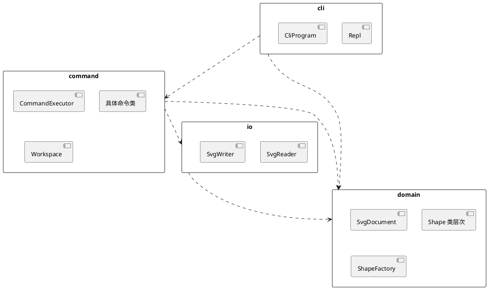

# SVG 编辑器 CLI 设计文档

对应题目 `phase_cli_1.md`（Lab1 Phase 1）。第 1 节的架构方案在写代码之前完成，实现中对方案的改动记入 1.6 修订记录。运行方式见仓库根目录的 `README.md`。

## 1 架构方案

### 1.1 模块划分

```text
src/
├── domain/    图形树（Composite）与文档 SvgDocument，命令的接收者
├── command/   命令类、命令执行器 CommandExecutor、工作区 Workspace
├── io/        SVG 文本与领域对象互转，文件读写
├── cli/       REPL、命令行解析与分发、tree/show 排版
└── main.ts    组装入口（唯一不含类的文件）
```

| 模块    | 职责                                                                                                          | 主要类                                                                                               |
| ------- | ------------------------------------------------------------------------------------------------------------- | ---------------------------------------------------------------------------------------------------- |
| domain  | 图形的类层次与文档级约束：id 唯一且区分大小写、容器关系不成环、题目 4.2 节的错误信息。不做 IO，不依赖任何库。 | `Shape` `Leaf` `Rect` `Circle` `Ellipse` `Line` `Text` `Group` `Canvas` `SvgDocument` `ShapeFactory` |
| command | 每条命令一个类。`CommandExecutor` 负责执行、undo/redo 两个栈和 IO 屏障；`Workspace` 保存当前文档与文件路径。  | `Command` `EditCommand` `DocumentCommand` `MoveCommand` 等具体命令，`CommandExecutor` `Workspace`    |
| io      | SVG 文本与领域对象之间的转换（基于 fast-xml-parser），文件读写；读入时为缺失的 id 自动编号并给出警告。        | `SvgReader` `SvgWriter`                                                                              |
| cli     | 逐行读入（node:readline），切分参数，交给 commander 找到对应命令，打印反馈；`tree`、`show` 的文本排版。       | `Repl` `CliProgram` `TreeCommand` `ShowCommand`                                                      |

模块关系（PlantUML 包图）：



### 1.2 设计模式的选择

#### Command（题目要求）

| 角色            | 本项目中的类                                           | 职责                                                                  |
| --------------- | ------------------------------------------------------ | --------------------------------------------------------------------- |
| Command         | `Command`（抽象类）                                    | `execute()` 返回反馈文本；`recordIn(executor)` 决定执行成功后怎样记账 |
| ConcreteCommand | `CreateCommand`、`MoveCommand`、`GroupCommand` 等      | 一条命令一个类，只把请求转发给接收者，自己不做校验                    |
| Client          | `CliProgram`                                           | 把一行输入解析成命令对象，并绑定接收者                                |
| Invoker         | `CommandExecutor`                                      | 执行命令，维护 undo 栈、redo 栈和 IO 屏障                             |
| Receiver        | `SvgDocument`（编辑类命令）、`Workspace`（文档类命令） | 知道怎样完成操作；校验和错误信息都在这里                              |

这对应课件中的"方式 5"：入口（REPL）只持有命令对象，并委托 `CommandExecutor` 执行，业务逻辑留在接收者里。

三类命令的区别由多态方法 `recordIn` 实现，执行器里没有类型判断：

- `EditCommand`（create、delete、move、scale、set、group、ungroup、addto、front、back）：把自己压入 undo 栈，并清空 redo 栈。
- `DocumentCommand`（init、read、save、canvas 改尺寸）：清空两个栈并设置 IO 屏障。之后 undo/redo 报 `error: undo not allowed after io command`，直到下一条编辑命令成功执行。
- 其余命令（tree、show、help、undo、redo、canvas 查询）：不记账。

命令执行失败时抛出异常，`recordIn` 不会被调用，所以失败的命令既不改变状态，也不进入历史。

undo 的做法：每条命令只保存撤销自己所需的最少信息，不做整文档快照。课件提醒过 AI 常给出快照方案，它的代价随文档大小增长。

| 命令                               | 保存的信息                                    | undo                                                                              |
| ---------------------------------- | --------------------------------------------- | --------------------------------------------------------------------------------- |
| create                             | 新图形对象及其位置（父容器、下标）            | 从父容器摘下                                                                      |
| delete                             | 被删除的子树及其位置                          | 原位插回，子树内的 id 一并恢复                                                    |
| move、scale                        | 受影响子树的几何属性备忘（`GeometryMemento`） | 恢复原值。没有用"反向移动、乘 1/f"，因为浮点运算不可逆，反复 undo/redo 会累积误差 |
| set                                | 旧值，或"原先没有这个属性"                    | 写回旧值，或删除该属性                                                            |
| group、ungroup、addto、front、back | 每个被移动图形原来的位置（`Placement`）       | 按相反顺序放回                                                                    |

`group g1 r1 c1 t1` 整体是一个命令对象，一次 undo 还原全部。

#### Composite

`Shape` 是组件，`Rect` `Circle` `Ellipse` `Line` `Text` 是叶子（共同父类 `Leaf`），`Group` 是容器，`Canvas`（根元素 `<svg>`）是一种特殊的 `Group`。`move`、`scale`、`setAttribute`、删除和 `describe`（tree 中的一行摘要）对叶子和容器一视同仁，容器的 move/scale 递归到每个子孙。

GoF 讨论过"透明"与"安全"两种 Composite 写法，本项目用安全写法：增删子节点的方法只在 `Group` 上，`Shape` 只提供只读的 `children()`；判断是否为容器用多态方法 `asGroup()`，不用 `instanceof`。

#### Template Method

几何属性的处理在 `Leaf` 中只写一次。子类声明自己的几何属性名（如 rect 的 `x y width height`）以及其中哪些是横坐标、哪些是纵坐标，`Leaf` 据此实现 move、scale、`set` 白名单和序列化；子类只覆盖 `describe()` 等真正不同的部分。这样既不必在每个子类里重复同样的代码，也不需要按类型名 `switch`。

#### 简单工厂

`ShapeFactory` 把类型名映射到图形类，`create` 命令和 `read` 读文件共用。这是题目允许的两处按名分派之一，标注为待重构（见 1.5）。

#### 局部备忘录与迭代器

`GeometryMemento` 和 `Placement` 只保存局部状态，由它们自己完成恢复（`restore()`），命令只负责保管。`Shape.walk()` 是生成器，按先序遍历子树，配合 ES2025 的迭代器辅助方法完成 id 查找、元素计数和成环检查。

#### 考虑过但没有采用

- Visitor：tree 输出和序列化看上去适合 Visitor，但课件给出的适用条件是"元素类型稳定、操作多变"。本题下一阶段会通过插件增加 `box` 等类型，每加一种类型所有 Visitor 都要改，和"内核新增代码为 0"的目标冲突。所以改为让每种图形自己提供摘要和属性列表，写出器和 tree 排版只做通用处理。
- Observer：目前只有 CLI 一个视图，等 GUI 阶段需要画布随文档刷新时再加。
- Singleton：各对象由 `main.ts` 组装后注入，测试时可以直接构造新实例。

### 1.3 依赖方向规则

| 模块    | 允许依赖                                    | 理由                                                                 |
| ------- | ------------------------------------------- | -------------------------------------------------------------------- |
| domain  | 无（不引入 `node:*`、Bun API 或任何库）     | 最稳定、复用最多，各种输入通道和插件阶段都建在它上面                 |
| io      | domain、`node:fs`、fast-xml-parser          | 文件格式和解析库的变化不影响模型                                     |
| command | domain、io                                  | 用例层。command 直接依赖 io 是有意保留的（题目允许本阶段 IO 未隔离） |
| cli     | command、domain、commander、`node:readline` | 只是输入通道之一，不直接读写文件                                     |

规则：依赖只能指向更稳定的模块；不允许循环依赖；跨模块导入一律写成 `#domain/…`、`#command/…` 这样的路径别名（package.json 的 `imports` 字段），禁止 `../` 相对导入，这样每一行 import 都能直接看出依赖方向。

执行方式：上表写在 `.oxlintrc.json` 中按目录覆盖的 `no-restricted-imports` 规则里，另有 `import/no-cycle`。编辑器、pre-commit 钩子和 CI 都运行 oxlint，违反规则的依赖无法提交，题目所说的"待处理项"在提交前就会暴露。

### 1.4 变化点假设

| #   | 可能的变化                              | 为它留了什么                                                                                                                       | 没留什么，为什么                                                   |
| --- | --------------------------------------- | ---------------------------------------------------------------------------------------------------------------------------------- | ------------------------------------------------------------------ |
| 1   | 插件增加图形类型（题目 4.4 的 `box`）   | 每种图形的行为都在自己的类里；写出器和 tree 排版不认识具体类型；读入时未知属性原样保留，`data-kind="box"` 在本阶段读回再保存不会丢 | 插件注册表和加载机制。本阶段只有内置类型，提前做只能凭猜测设计接口 |
| 2   | 增加新命令                              | 一条命令一个类；help 文本由 commander 根据注册信息生成                                                                             | 命令自动注册。集中注册更直观，也是题目要求标注的待重构点           |
| 3   | 新的输入通道（agent、鼠标）             | domain 和 command 不接触终端；命令返回纯文本反馈，agent 也能直接读                                                                 | Observer 等事件机制。还没有第二个视图                              |
| 4   | 存储格式变化、IO 需要隔离               | 文件与 XML 相关代码全部在 io                                                                                                       | `DocumentStore` 之类的接口。目前只有一种实现，接口只会多一层转发   |
| 5   | 寻址方式扩展（题目提到的类 XPath 路径） | 所有查找都经过 `SvgDocument.find`                                                                                                  | 路径解析本身，本阶段不要求                                         |

### 1.5 待重构标注

| 位置                         | 现状                                   | 计划                                                                  |
| ---------------------------- | -------------------------------------- | --------------------------------------------------------------------- |
| `src/cli/CliProgram.ts`      | 命令名到命令类的分发（commander 注册） | 插件化阶段改为由命令提供者注册                                        |
| `src/domain/ShapeFactory.ts` | 类型名到图形类的分发                   | 替换为 `ShapeProvider` 注册表                                         |
| command 直接依赖 io          | IO 未隔离                              | 出现第二种存储方式或需要替身测试时，在 command 中定义接口，由 io 实现 |

代码里这几处都有 `待重构` 注释，`grep -rn 待重构 src` 可以找到。

### 1.6 修订记录

| 日期       | 改动     | 原因 |
| ---------- | -------- | ---- |
| 2026-10-24 | 初版方案 |      |

## 2 过程记录

与 AI（Claude Code）协作中有代表性的讨论与修正，按时间顺序：

1. 规划阶段：读题目时发现三处 tree 示例的列对齐方式不一致。5.1 节和第 6 节是"最长标签加 2 个空格"，4.4 节是"加 1 个空格"，6.1 节版本 A 还有一行只空了 1 格，没有一条规则能同时满足。决定采用第一种，端到端测试比较输出时把连续空白视为一个空格。
2. 规划阶段：调研工具时发现 TypeScript 7.0 不再提供编译器 API，依赖它的 dependency-cruiser 和 typescript-eslint 用不了，于是改用 oxlint 的 `no-restricted-imports` 按目录检查依赖方向。
3. 规划阶段：方案比较了 undo 的两种做法。move 和 scale 的反向运算（减去位移、乘 1/f）有浮点误差，所以这两条命令保存受影响图形的几何备忘录，其余命令保存位置信息或旧值。
4. 规划阶段：考虑过用 Visitor 实现 tree 输出和序列化，因下一阶段会持续增加图形类型而放弃（见 1.2）。

（后续条目在实现过程中补充。）

## 3 一致性自查

（实现完成后填写。）

## 4 质量保证手段

计划采用的手段如下，结果数字在实现完成后补充。

| 层次         | 内容                                                                                                                        | 工具                     |
| ------------ | --------------------------------------------------------------------------------------------------------------------------- | ------------------------ |
| 接收者       | `SvgDocument` 与各图形类的单元测试，覆盖题目 4.2 节中本阶段适用的每条错误信息                                               | bun:test                 |
| 命令与执行器 | 每条编辑命令：执行前的 SVG 文本等于 undo 后的文本，执行后的文本等于 redo 后的文本；栈规则与 IO 屏障；随机命令序列的性质测试 | bun:test、fast-check     |
| IO           | 自动补 id 不与文件中后出现的 id 冲突、重复 id、读写往返、题目示例逐字节一致                                                 | bun:test                 |
| 端到端       | 题目第 6 节的会话原样作为测试数据逐行回放；另有一个真实进程的冒烟测试                                                       | bun:test、`Bun.spawn`    |
| 静态检查     | 格式、lint（含依赖规则）、TypeScript 严格模式、无用代码检查、覆盖率阈值（行与函数 90%）                                     | oxfmt、oxlint、tsc、knip |

pre-commit 钩子运行格式检查、lint 和类型检查；GitHub Actions 在每次推送时运行 `bun run check`。

## 附录 A 题目未明确之处与本实现的约定

| #   | 问题                                      | 约定                                                                                           |
| --- | ----------------------------------------- | ---------------------------------------------------------------------------------------------- |
| 1   | tree 示例的列对齐方式不一致               | 摘要列对齐到"最长标签 + 2 个空格"                                                              |
| 2   | `group` 的新容器放在哪里，成员按什么顺序  | 新容器放在第一个成员（按文档顺序）原来的位置；成员保持文档中的相对顺序                         |
| 3   | 部分命令的成功反馈没有给出格式            | 实现时统一补全，列在本附录末尾                                                                 |
| 4   | 读入文件中的不支持元素、重复 id、格式错误 | 不支持的元素跳过并警告；重复 id 按缺失处理（自动编号并警告）；XML 格式错误时报错，当前文档不变 |
| 5   | tree 中显示哪些属性                       | 几何属性加 fill。题目示例里用 black 创建的 line 在 tree 中不显示 stroke                        |
| 6   | init 之后无参数 `save`                    | 报错，提示指定文件名                                                                           |
| 7   | IO 屏障之后 undo 能否越过它               | 不能，文档类命令会清空 undo/redo 历史                                                          |
