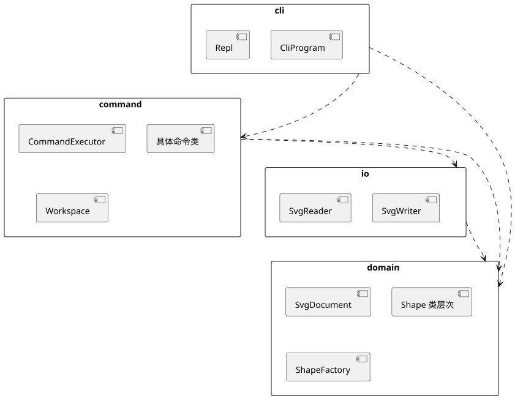
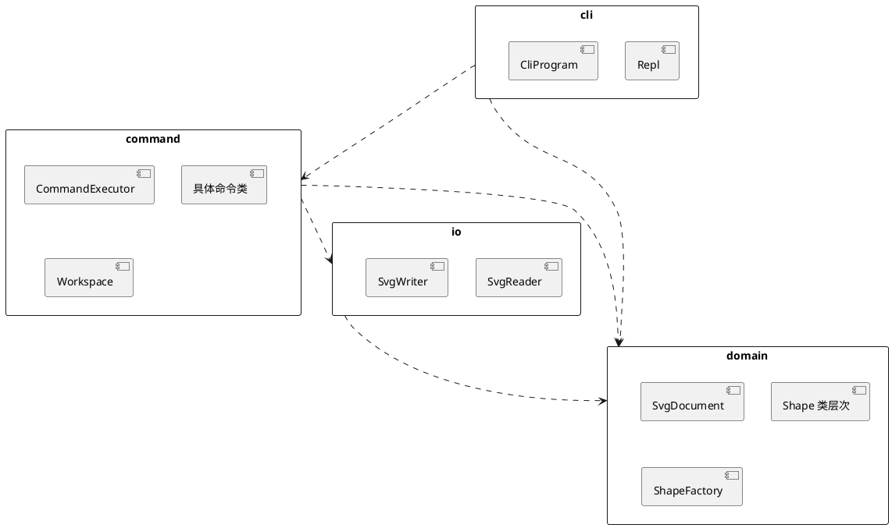

# SVG 编辑器 CLI 设计文档

本文档对应题目 `phase_cli_1.md`（Lab1 Phase 1）。第 1 节的架构方案是在写代码之前完成的，实现过程中对方案的改动都记在 1.6 修订记录里。运行方式见仓库根目录的 `README.md`。

## 1 架构方案

### 1.1 模块划分

```text
src/
├── domain/    图形树（Composite）与文档 SvgDocument，命令的接收者
├── command/   命令类（含 tree、show 等显示类命令）、命令执行器 CommandExecutor、工作区 Workspace
├── io/        SVG 文本与领域对象互转，文件读写
├── cli/       REPL、命令行解析与分发
└── main.ts    组装入口（唯一不含类的文件）
```

| 模块    | 职责                                                                                                                                                                                           | 主要类                                                                                                          |
| ------- | ---------------------------------------------------------------------------------------------------------------------------------------------------------------------------------------------- | --------------------------------------------------------------------------------------------------------------- |
| domain  | 图形的类层次，以及文档级的约束：id 唯一且区分大小写，容器关系不成环，错误信息与题目 4.2 节一致。这个模块不做 IO，也不依赖任何库。                                                              | `Shape` `Leaf` `Rect` `Circle` `Ellipse` `Line` `Text` `Group` `Canvas` `SvgDocument` `ShapeFactory`            |
| command | 每条命令对应一个类。tree、show、help 这些显示类命令也是命令，它们返回排好版的文本。`CommandExecutor` 负责执行命令，并管理 undo/redo 两个栈和 IO 屏障；`Workspace` 保存当前文档和它的文件路径。 | `Command` `EditCommand` `DocumentCommand` `MoveCommand` `TreeCommand` 等具体命令，`CommandExecutor` `Workspace` |
| io      | 负责 SVG 文本与领域对象之间的转换（解析用 fast-xml-parser，格式检查用 fast-xml-validator，写出用 fast-xml-builder）和文件读写。读入时，它为缺失的 id 自动编号并给出警告。                      | `SvgReader` `SvgWriter`                                                                                         |
| cli     | 用 node:readline 逐行读入输入（按 Tab 可以补全命令名和 id），切分参数，交给 commander 找到对应的命令，再打印反馈。在终端上，错误显示为红色。                                                   | `Repl` `CliProgram`                                                                                             |

下图是模块之间的依赖关系。它是一张 PlantUML 包图，由下方的源码在 plantuml.com 上渲染生成：



<details>
<summary>PlantUML 源码</summary>



</details>

### 1.2 设计模式的选择

#### Command（题目要求）

| 角色            | 本项目中的类                                           | 职责                                                                      |
| --------------- | ------------------------------------------------------ | ------------------------------------------------------------------------- |
| Command         | `Command`（抽象类）                                    | `execute()` 返回反馈文本；`recordIn(executor)` 决定执行成功后怎样记入历史 |
| ConcreteCommand | `CreateCommand`、`MoveCommand`、`GroupCommand` 等      | 每条命令一个类。具体命令只把请求转发给接收者，自己不做校验                |
| Client          | `CliProgram`                                           | 把一行输入解析成命令对象，并绑定接收者                                    |
| Invoker         | `CommandExecutor`                                      | 执行命令，维护 undo 栈、redo 栈和 IO 屏障                                 |
| Receiver        | `SvgDocument`（编辑类命令）、`Workspace`（文档类命令） | 知道怎样完成操作，校验和错误信息也都在这里                                |

这种结构对应课件中的"方式 5"：入口（REPL）只持有命令对象，并委托 `CommandExecutor` 执行它，业务逻辑则留在接收者里。

三类命令在记录历史上的区别由多态方法 `recordIn` 实现，执行器里没有类型判断：

- `EditCommand`（create、delete、move、scale、set、group、ungroup、addto、front、back）：把自己压入 undo 栈，并清空 redo 栈。
- `DocumentCommand`（init、read、save、canvas 改尺寸）：清空两个栈并设置 IO 屏障。此后执行 undo 或 redo 会报 `error: undo not allowed after io command`，直到下一条编辑命令成功执行为止。
- 其余命令（tree、show、help、undo、redo、canvas 查询）：不记入历史。

命令执行失败时抛出异常，`recordIn` 不会被调用，所以失败的命令既不改变状态，也不进入历史。

undo 的做法是：每条命令只保存撤销自己所需的最少信息，不对整个文档做快照。课件提醒过，AI 常常给出快照方案，而快照的代价会随文档变大而增长。

| 命令                               | 保存的信息                                    | undo                                                                                        |
| ---------------------------------- | --------------------------------------------- | ------------------------------------------------------------------------------------------- |
| create                             | 新图形对象及其位置（父容器、下标）            | 从父容器中摘下                                                                              |
| delete                             | 被删除的子树及其位置                          | 插回原来的位置，子树内的 id 也一起恢复                                                      |
| move、scale                        | 受影响子树的几何属性备忘（`GeometryMemento`） | 恢复原值。这里没有用"反向移动、乘 1/f"的做法，因为浮点运算不可逆，反复 undo/redo 会累积误差 |
| set                                | 旧值，或"原先没有这个属性"                    | 写回旧值，或删除该属性                                                                      |
| group、ungroup、addto、front、back | 每个被移动图形原来的位置（`Placement`）       | 按相反顺序放回                                                                              |

`group g1 r1 c1 t1` 整体是一个命令对象，所以一次 undo 就能还原全部改动。

#### Composite

`Shape` 是组件，`Rect` `Circle` `Ellipse` `Line` `Text` 是叶子（共同父类 `Leaf`），`Group` 是容器，`Canvas`（根元素 `<svg>`）是一种特殊的 `Group`。`move`、`scale`、`setAttribute`、删除和 `describe`（tree 中的一行摘要）对叶子和容器的处理方式相同；容器的 move/scale 会递归到每个子孙。

GoF 讨论过"透明"和"安全"两种 Composite 写法，本项目采用安全写法：增删子节点的方法只在 `Group` 上，`Shape` 只提供只读的 `children()`。判断一个图形是不是容器时，代码调用多态方法 `asGroup()`，不使用 `instanceof`。

#### Template Method

几何属性的处理逻辑在 `Leaf` 中只写一次。子类用 `geometry()` 声明自己有哪些几何属性（例如 rect 的 `x y width height`），以及每个属性在 move 时随 dx 变、随 dy 变还是保持不变（尺寸属于最后一种，而且不能为负）。`Leaf` 根据这些声明实现 move、scale、`set` 的白名单和序列化。子类只覆盖 `summary()` 等真正不同的部分，例如 rect 在 tree 中把 width/height 缩写成 `w=`/`h=`。这样既不必在每个子类里重复同样的代码，也不需要按类型名写 `switch`。

#### 值对象

`Decimal` 是不可变的数值类型，几何属性、画布尺寸、move 的位移和 scale 的倍数都用它表示。它按 SVG 的数值语法解析文本，输出时最多保留 6 位小数并去掉 `-0`，所以 `0.1 + 0.2` 显示为 `0.3`。方法签名里的参数类型如果是 `Decimal`，就说明这个值已经校验过。

#### 简单工厂

`ShapeFactory` 把类型名映射到图形类，`create` 命令和读文件的 `read` 命令都使用它。这是题目允许的两处按名分派之一，已经标注为待重构（见 1.5）。

#### 局部备忘录与迭代器

接收者 `SvgDocument` 的每个编辑方法都返回一个备忘录（`Memento` 接口，只有一个 `restore()` 方法）。命令只负责保管备忘录，在 undo 时调用它的 `restore()`：

| 备忘录             | 保存的内容                       | 用于                               |
| ------------------ | -------------------------------- | ---------------------------------- |
| `GeometryMemento`  | 一个叶子的几何属性值             | move、scale（容器由 Journal 组合） |
| `Placement`        | 一个图形当时的父容器和下标       | create、delete、addto、front、back |
| `AttributeMemento` | 一个属性的旧值（或"原来没有"）   | set                                |
| `Journal`          | 多个备忘录，按从新到旧的顺序恢复 | group、ungroup                     |

`Journal` 中的每个 `Placement` 都是在对应的那一步执行之前记录的，下标反映的是当时的状态，所以按倒序恢复就能精确还原（见过程记录 2）。

`Shape.walk()` 是一个生成器，它按先序遍历子树。代码配合 ES2025 的迭代器辅助方法，用它完成 id 查找、元素计数和成环检查。

#### 考虑过但没有采用

- Visitor：tree 输出和序列化看上去适合 Visitor，但课件给出的适用条件是"元素类型稳定、操作多变"。本题下一阶段会通过插件增加 `box` 等类型，每加一种类型，所有 Visitor 都要修改，这和"内核新增代码为 0"的目标冲突。所以本项目让每种图形自己提供摘要和属性列表，写出器和 tree 排版只做通用处理。
- Observer：目前只有 CLI 这一个视图。等到 GUI 阶段需要画布随文档刷新时再加。
- Singleton：各个对象由 `main.ts` 组装后注入，所以测试时可以直接构造新的实例。

### 1.3 依赖方向规则

| 模块    | 允许依赖                                                                 | 理由                                                                     |
| ------- | ------------------------------------------------------------------------ | ------------------------------------------------------------------------ |
| domain  | 无（不引入 `node:*`、Bun API 或任何库）                                  | 它最稳定、复用最多，各种输入通道和插件阶段都建立在它上面                 |
| io      | domain、`node:fs`、fast-xml-parser、fast-xml-validator、fast-xml-builder | 文件格式和解析库的变化不影响模型                                         |
| command | domain、io                                                               | 这是用例层。command 直接依赖 io 是有意保留的（题目允许本阶段 IO 未隔离） |
| cli     | command、domain、commander、`node:readline` 等（`node:fs` 除外）         | 它只是输入通道之一，不直接读写文件                                       |

具体规则有三条。第一，依赖只能指向更稳定的模块。第二，不允许循环依赖。第三，跨模块导入一律写成 `#domain/…`、`#command/…` 这样的路径别名（定义在 package.json 的 `imports` 字段中），禁止使用 `../` 相对导入，这样从每一行 import 都能直接看出依赖方向。

这些规则由工具执行：上表写成了 `.oxlintrc.json` 中按目录覆盖的 `no-restricted-imports` 规则，循环依赖由 `import/no-cycle` 检查。编辑器、pre-commit 钩子和 CI 都运行 oxlint，所以违反规则的依赖无法提交，题目所说的"待处理项"在提交之前就会暴露出来。

### 1.4 变化点假设

| #   | 可能的变化                              | 为它留了什么                                                                                                                                                                                                                    | 没留什么，为什么                                                                |
| --- | --------------------------------------- | ------------------------------------------------------------------------------------------------------------------------------------------------------------------------------------------------------------------------------- | ------------------------------------------------------------------------------- |
| 1   | 插件增加图形类型（题目 4.4 的 `box`）   | 每种图形的行为都在自己的类里，写出器和 tree 排版不认识具体类型。help 中 create 的参数表由各图形的 `createSignature()` 生成，新类型注册后会自动出现。读入时未知属性原样保留，所以 `data-kind="box"` 在本阶段读入再保存也不会丢失 | 没有做插件注册表和加载机制。本阶段只有内置类型，提前做只能凭猜测设计接口        |
| 2   | 增加新命令                              | 每条命令一个类，help 文本由 commander 根据注册信息生成                                                                                                                                                                          | 没有做命令自动注册。集中注册更直观，这里也是题目要求标注的待重构点              |
| 3   | 新的输入通道（agent、鼠标）             | domain 和 command 不接触终端，命令返回纯文本反馈，agent 也能直接读取                                                                                                                                                            | 没有做 Observer 等事件机制，因为还没有第二个视图                                |
| 4   | 存储格式变化、IO 需要隔离               | 与文件和 XML 相关的代码全部在 io 中                                                                                                                                                                                             | 没有定义 `DocumentStore` 之类的接口。目前只有一种实现，这样的接口只会多一层转发 |
| 5   | 寻址方式扩展（题目提到的类 XPath 路径） | 所有查找都经过 `SvgDocument.find`                                                                                                                                                                                               | 没有实现路径解析，本阶段不要求                                                  |

### 1.5 待重构标注

| 位置                         | 现状                                   | 计划                                                                  |
| ---------------------------- | -------------------------------------- | --------------------------------------------------------------------- |
| `src/cli/CliProgram.ts`      | 命令名到命令类的分发（commander 注册） | 插件化阶段改为由命令提供者注册                                        |
| `src/domain/ShapeFactory.ts` | 类型名到图形类的分发                   | 替换为 `ShapeProvider` 注册表                                         |
| command 直接依赖 io          | IO 未隔离                              | 出现第二种存储方式或需要替身测试时，在 command 中定义接口，由 io 实现 |

代码里这几处都有 `待重构` 注释，用 `grep -rn 待重构 src` 可以找到它们。

### 1.6 修订记录

| 日期       | 改动                                                                                    | 原因                                                                                                                  |
| ---------- | --------------------------------------------------------------------------------------- | --------------------------------------------------------------------------------------------------------------------- |
| 2026-10-24 | 初版方案                                                                                |                                                                                                                       |
| 2026-10-24 | 数值处理从静态工具类改为 `Decimal` 值对象                                               | oxlint 报告只有静态成员的类，见过程记录 1                                                                             |
| 2026-10-24 | tree、show 的排版从 cli 移到 command，成为显示类命令                                    | 它们和编辑命令一样是用例，agent 等其他输入通道也要用。如果留在 cli，别的通道只能依赖 cli，或者重写一遍                |
| 2026-10-24 | 端到端测试从"进程内回放加一个冒烟测试"改为全部用真实进程回放                            | 会话里有 save 和 read，每个会话需要自己的工作目录。子进程可以单独指定工作目录，进程内回放只能改全局的 `process.chdir` |
| 2026-10-25 | io 改用 fast-xml-validator 检查 XML 格式、fast-xml-builder 写出；lint 开启弃用 API 检查 | fast-xml-parser 的 `XMLValidator` 和 `XMLBuilder` 已标记为弃用，见过程记录 6                                          |

## 2 过程记录

### 2.1 开发中发现并修正的问题

本项目的方案、代码和测试都由 AI（Claude Code）编写。下面按时间顺序，列出几个与软件设计有关、比较有代表性的问题。

1. 图形类实现：AI 起初把数值的解析和格式化写成了只有静态方法的 `Numbers` 类。oxlint 的 `typescript/no-extraneous-class` 规则报了错，并建议改成独立的函数，但题目禁止自由函数。只有静态方法的类，其实就是套了一层类的自由函数，所以 AI 最后把它改成了 `Decimal` 值对象，让解析、运算和输出都成为数值自己的方法。
2. 接收者实现：方案里只写了"结构类命令保存 Placement，逆序恢复"。AI 在实现 group 时，用六个兄弟节点 a 到 f 推演了 `group g e a c` 这条命令。如果在执行前一次性记下所有成员的下标，倒序恢复后 e 和 f 的顺序会颠倒，因为新容器插入以后，其余节点的下标已经变了。所以 AI 改为在每一步执行之前才记录 `Placement`，并用测试 "the members keep document order, and the group takes the place of the first member" 覆盖了这个例子。
3. 结构类命令实现：随机命令序列的性质测试（全部 undo、全部 redo 都能回到对应的状态）一直能通过。但是 AI 用 `fc.sample` 统计生成的序列之后发现，ungroup 和 addto 几乎没有成功执行过。起始文档里没有容器，随机序列又很少先造出嵌套的容器，所以这两条命令基本都在报错。这时测试通过，只能证明"失败的命令不改变状态"。于是 AI 改为从带两层嵌套容器的文档开始，扩大了 id 的取值范围，并把运行次数加到了 500 次。
4. 读写实现：读入文件时，fast-xml-parser 返回的结果是 `any` 类型。AI 起初用 `as` 把结果直接断言成节点类型，oxlint 的 `no-unsafe-type-assertion` 规则因此报错。后来 AI 改为在 io 模块里做运行时检查：用 `Array.isArray` 判断数组，属性按 `typeof` 过滤后再放进 `Map`。这样，形状不对的数据就不会带着错误的类型进入领域层。
5. 变异测试：AI 第一次运行 Stryker 时，行覆盖率已经是 100%，变异测试的得分却只有 92.01%（1102 个变异体，存活 88 个）。AI 逐个查看了存活的变异体，发现其中 22 个对应测试真正漏掉的地方。例如，没有测试解析过 `12.5`、`.25`、`1E-3` 这类数，所以数值语法的正则即使改坏了，测试也发现不了。又如，所有执行器测试都先执行 init，所以执行器刚创建时的状态从来没有被检查过。另外还有两行代码，删掉以后测试照样通过。AI 用小脚本确认它们确实多余，就把它们删掉了。补了测试、删了代码之后，得分升到了 94.27%。换用 fast-xml-validator 和 fast-xml-builder（过程记录 6）之后，AI 又运行了一次，并把"文件不存在"的测试改成比较完整的错误信息。现在还剩 69 个存活变异体，分类见 4.2 节。
6. 弃用 API：我在编辑器里看到了 `XMLValidator` 的弃用提示，于是请 AI 扫描全部代码，替换弃用的 API。原来 AI 在实现读写功能时，选用了 fast-xml-parser 自带的 `XMLValidator` 和 `XMLBuilder`，当时没有发现它们已经被标记为弃用。TypeScript 只在编辑器里把弃用显示为提示，`tsc` 不会因此报错，lint 也没有开启相应的规则，所以所有检查一直都能通过。AI 用 oxlint 的 `typescript/no-deprecated` 规则扫描了全部源码和测试，只找到这两处，于是把它们换成了弃用说明里推荐的 fast-xml-validator 和 fast-xml-builder。这条规则现在设为 error，以后如果再用到弃用的 API，提交和 CI 都会失败。另外，依赖规则里原来按包名写的是 `fast-xml-parser`，现在改成了 `fast-xml-`，这样新加的两个包也受模块边界的约束。domain 和 command 的规则还补上了之前漏掉的 `@commander-js/`。

## 3 一致性自查

2026-10-25 实现完成以后，对照第 1 节逐条检查了代码。每一项都写明了检查方法，可以在仓库根目录重新运行这些检查。

### 3.1 模块与依赖方向

| 模块    | 实际导入（`grep -rhoE "from '[^']+'" src/<模块>`，去重）                                   | 结论                                                                                                        |
| ------- | ------------------------------------------------------------------------------------------ | ----------------------------------------------------------------------------------------------------------- |
| domain  | `#domain`                                                                                  | 与 1.3 节一致，没有 `node:*`、Bun API 或任何库                                                              |
| io      | `#domain`、fast-xml-builder、fast-xml-parser、fast-xml-validator、`node:fs`                | 一致                                                                                                        |
| command | `#command`、`#domain`、`#io`                                                               | 一致                                                                                                        |
| cli     | `#cli`、`#command`、`#domain`、`@commander-js/extra-typings`、`node:readline`、`node:util` | 一致，没有 `node:fs`。`@commander-js/extra-typings` 是 commander 官方的类型增强包，运行时用的就是 commander |
| main.ts | `#cli`、`#command`                                                                         | 这是组装入口，不受 1.3 节的限制                                                                             |

模块划分与 1.1 节一致，唯一的改动（tree、show 移到 command）已经记在 1.6 节。oxlint 的 `import/no-cycle` 检查通过，说明没有循环依赖。

### 3.2 依赖规则确实会拦下违规

为了确认这些规则真的会生效，临时在 domain 中加了一个同时违反三条规则的文件 `src/domain/Probe.ts`：它导入 `node:fs`，导入 cli 的类，并用 `../` 跨模块导入。oxlint 报出了三个错误，并以退出码 1 结束，所以 pre-commit 钩子和 CI 都会因此失败：

```text
src/domain/Probe.ts:1:1: error eslint(no-restricted-imports): 'node:fs' import is restricted from being used by a pattern. help: domain does no IO and uses no libraries.
src/domain/Probe.ts:3:1: error eslint(no-restricted-imports): '#cli/Repl.ts' import is restricted from being used by a pattern. help: domain must not depend on any other module.
src/domain/Probe.ts:5:1: error eslint(no-restricted-imports): '../command/Workspace.ts' import is restricted from being used by a pattern. help: Cross-module imports must use the #domain/ #command/ #io/ #cli/ aliases.
```

检查完以后，这个文件已经删除。

### 3.3 面向对象与命令模式的规则

| 规则                           | 检查方法                                                                                          | 结果                                                                                                                                                               |
| ------------------------------ | ------------------------------------------------------------------------------------------------- | ------------------------------------------------------------------------------------------------------------------------------------------------------------------ |
| 一个文件一个类，文件名就是类名 | oxlint 的 `max-classes-per-file`、`unicorn/filename-case`；另用脚本比对每个文件导出的类名与文件名 | src 下 48 个文件：46 个各有一个同名的类，`Memento.ts` 是同名接口，`main.ts` 是唯一没有类的文件                                                                     |
| 没有自由函数                   | `grep -rnE "^(export )?function\|^(export )?const \w+ = \(" src`                                  | 没有匹配                                                                                                                                                           |
| 不按图形类型分派               | `grep -rnE "instanceof\|switch *\(" src`                                                          | 没有 `switch`。`instanceof` 有 5 处，都只用来区分错误类型（`EditorError`、`CommanderError`，以及校验器抛出的 `Error`）。判断是否为容器时，用的是多态的 `asGroup()` |
| 按名称分派只有两处             | 阅读代码，找字符串到类或命令的映射                                                                | 只有 `ShapeFactory` 的类型表和 `CliProgram` 的 commander 注册两处，都标了 `待重构`                                                                                 |
| 封装                           | 检查各个类的字段                                                                                  | 实例状态都在 `#` 私有字段里。公开字段只有各图形类的 `readonly tag`，它是常量                                                                                       |
| 具体命令只转发，不做校验       | `grep -rln "throw " src/command`，并逐个阅读命令类                                                | 会抛错的只有 `Workspace`（接收者）和 `CommandExecutor`（调用者）。调用者抛出的 `nothing to undo` 和 `undo not allowed after io command` 属于历史栈自己的规则       |
| 命令不打印                     | `grep -rnE "console\.\|process\.std" src/domain src/command src/io`                               | 没有匹配，只有 `Repl` 和 `main.ts` 接触输入输出                                                                                                                    |
| undo 不做整文档快照            | `grep -rnE "serialize\|structuredClone\|clone" src/command src/domain`，并阅读各命令的 undo       | 没有匹配，command 里只有 `Workspace` 为 save 持有 `SvgWriter`。各命令只保存 1.2 节表中的备忘录                                                                     |

### 3.4 对照题目

| 题目内容                         | 验证方式                                                                           |
| -------------------------------- | ---------------------------------------------------------------------------------- |
| 第 6 节、6.1 节版本 A 的完整会话 | 端到端测试用真实进程逐行回放，保存出的文件与期望文件逐字节比较                     |
| 5.1、5.2 节 tree 和 show 的示例  | 命令层测试逐字符比较                                                               |
| 0.1 节的示例 SVG                 | 读入再写出，与原文逐字节一致                                                       |
| 4.2、4.3 节的错误信息            | 共 13 条。`cannot ungroup composite shape` 属于 `box` 插件阶段，其余 12 条都有测试 |
| 4.4 节和 6.1 节版本 B 的 `box`   | 属于下一阶段，本阶段没有实现                                                       |

### 3.5 自查中发现的不一致

1.5 节写着"代码里这几处都有 `待重构` 注释"，但检查时发现只有两个分派点有这个注释，"command 直接依赖 io"这一处没有。现在 `Workspace.ts` 已经补上了注释，`grep -rn 待重构 src` 能找到全部三处。

## 4 质量保证手段

### 4.1 手段

| 层次         | 内容                                                                                                                                                                                 | 工具                         |
| ------------ | ------------------------------------------------------------------------------------------------------------------------------------------------------------------------------------ | ---------------------------- |
| 接收者       | `SvgDocument` 与各图形类的单元测试，覆盖题目 4.2 节中本阶段适用的每条错误信息                                                                                                        | bun:test                     |
| 命令与执行器 | 对每条编辑命令，检查执行前的 SVG 文本等于 undo 后的文本，执行后的文本等于 redo 后的文本。另外测试栈规则和 IO 屏障，并对随机命令序列做性质测试                                        | bun:test、fast-check         |
| IO           | 检查自动补的 id 不与文件中后出现的 id 冲突、重复 id 的处理、读写往返，以及题目示例逐字节一致                                                                                         | bun:test                     |
| 端到端       | 题目第 6 节和 6.1 节（版本 A）的会话原样作为测试数据，用真实进程逐行回放，保存出的文件与按题目推导出的期望文件逐字节比较。另有一个带语法错误的脚本，用来确认错误只在 stdout 打印一行 | bun:test、`Bun.spawn`        |
| 静态检查     | 格式、lint（含依赖规则和弃用 API 检查）、TypeScript 严格模式、无用代码检查、覆盖率阈值（行与函数 90%）                                                                               | oxfmt、oxlint、tsc、knip     |
| 变异测试     | 在源码里逐个植入小改动（变异体），对每个变异体跑一遍全部测试，看测试能否发现这个改动。变异测试检验的是测试本身：覆盖率只能说明代码被执行过，不能说明结果被检查过                     | Stryker 10（command 运行器） |

pre-commit 钩子运行格式检查、lint 和类型检查，GitHub Actions 在每次推送时运行 `bun run check`。变异测试要跑大约 3 分钟，所以没有放进钩子和 CI，需要用 `bun run mutation` 手动运行。

### 4.2 结果（2026-10-25）

| 指标         | 结果                                                                                                                                                                                                                                                                                                   |
| ------------ | ------------------------------------------------------------------------------------------------------------------------------------------------------------------------------------------------------------------------------------------------------------------------------------------------------ |
| 测试         | 共 114 个：domain 49 个、command 35 个、io 16 个、cli 11 个、端到端 3 个。断言约 3700 次。性质测试的命令序列是随机生成的，所以每次运行的断言数略有不同                                                                                                                                                 |
| 覆盖率       | 行覆盖率 100%，函数覆盖率 99.94%。唯一不到 100% 的是 `CliProgram.ts`（函数 97.06%）：交给 commander 的 `writeOut` 是空函数，commander 只在自己输出帮助时才调用它，而 help 命令是先取出帮助文本，再把它返回                                                                                             |
| 性质测试     | 运行 500 次，每次最多 30 条随机编辑命令，起始文档带两层嵌套容器。全部 undo 之后回到初始 SVG，全部 redo 之后回到最终 SVG                                                                                                                                                                                |
| 题目错误信息 | 本阶段适用的 12 条都有测试（见 3.4）                                                                                                                                                                                                                                                                   |
| 变异测试     | 第一次运行有 1102 个变异体，存活 88 个，得分 92.01%。按结果补了测试、删掉两行多余的代码之后，变异体是 1099 个，存活 63 个，得分 94.27%（过程记录 5）。换用 fast-xml-validator 和 fast-xml-builder（过程记录 6）并收紧一个测试之后，变异体是 1111 个，存活 69 个，得分 93.79%，没有超时或未覆盖的变异体 |
| 静态检查     | oxlint（类型感知，警告也算失败）、tsc 严格模式、knip 都没有发现问题                                                                                                                                                                                                                                    |

最近一次运行剩下的 69 个存活变异体都逐个看过。这些改动都不会产生可以观察到的差别：

| 类别                      | 数量 | 例子                                                                                                                                  |
| ------------------------- | ---- | ------------------------------------------------------------------------------------------------------------------------------------- |
| 防御性的空值判断          | 21   | undo 中的 `this.#memento?.restore()`。undo 只会在 execute 之后调用，所以备忘录一定存在。同样，文档中的图形也一定有父容器              |
| 结果相同或走不到的分支    | 15   | `?? ''` 这样的默认值（切分参数的正则每次匹配时总有一组有值）；`#warnings` 的初始值（每次解析前都会清空）；画布的 id（从来不会被查找） |
| 用户看不到的文字          | 9    | commander 的参数说明（help 只显示参数名）、程序名、`EditorError.name`                                                                 |
| 库已经保证的行为          | 15   | fast-xml-parser 已经去掉属性值两端的空白；解析结果中标签名总在 `':@'` 之前；属性值总是字符串                                          |
| 只在别处有 bug 时才起作用 | 9    | 把意外的异常原样抛出、不包装成用户错误的判断                                                                                          |

要杀死这些变异体，只能去测试实现细节，或者故意制造 bug，所以没有再为它们补测试。

### 4.3 这些手段拦下的问题

| 手段               | 拦下的问题                                                                                                     |
| ------------------ | -------------------------------------------------------------------------------------------------------------- |
| pre-commit 钩子    | 第 2 步提交时，tsc 报了 TS18048（`Leaf.movedPhrase` 中的值可能是 `undefined`），提交被拒绝，修正之后才提交成功 |
| oxlint             | 只有静态方法的类（过程记录 1）；对库返回值的不安全类型断言（过程记录 4）                                       |
| 统计生成的测试数据 | 性质测试几乎没有执行 ungroup 和 addto（过程记录 3）                                                            |
| 变异测试           | 覆盖率 100% 时仍然漏掉的测试，以及两行多余的代码（过程记录 5）                                                 |
| 一致性自查         | 1.5 节与代码不符（3.5）                                                                                        |

## 附录 A 题目未明确之处与本实现的约定

| #   | 问题                                      | 约定                                                                                                                                                                                                                                                                                                                                                                                                                                    |
| --- | ----------------------------------------- | --------------------------------------------------------------------------------------------------------------------------------------------------------------------------------------------------------------------------------------------------------------------------------------------------------------------------------------------------------------------------------------------------------------------------------------- |
| 1   | tree 示例的列对齐方式不一致               | 摘要列对齐到"最长标签 + 2 个空格"                                                                                                                                                                                                                                                                                                                                                                                                       |
| 2   | `group` 的新容器放在哪里，成员按什么顺序  | 新容器放在第一个成员（按文档顺序）原来的位置；成员保持文档中的相对顺序                                                                                                                                                                                                                                                                                                                                                                  |
| 3   | 部分命令的成功反馈没有给出格式            | 实现时统一补全了这些格式，列在本附录末尾                                                                                                                                                                                                                                                                                                                                                                                                |
| 4   | 读入文件中的不支持元素、重复 id、格式错误 | 不支持的元素连同它的子元素一起跳过：`warning: skipped <path id="p1">: unsupported element`。重复的 id 按缺失处理：`warning: assigned id rect2 to <rect> with duplicate id r1`；自动编号会跳过文件中任何位置已有的 id。属性值无法使用的元素也会跳过，例如带单位的数值：`warning: skipped <rect id="r1">: invalid number: 10px`。叶子元素里的子元素（如 `<text>` 里的 `<tspan>`）会被跳过并给出警告。XML 格式错误时报错，当前文档保持不变 |
| 5   | tree 中显示哪些属性                       | 显示几何属性和 fill。题目示例里用 black 创建的 line，在 tree 中不显示 stroke                                                                                                                                                                                                                                                                                                                                                            |
| 6   | init 之后无参数 `save`                    | 报 `error: no file name. use 'save <file.svg>'`。执行 `save <file>` 之后，无参数的 `save` 会写到这个新文件（与常见编辑器的"另存为"一致）；`init` 会清掉记住的文件                                                                                                                                                                                                                                                                       |
| 7   | IO 屏障之后 undo 能否越过它               | 不能，文档类命令会清空 undo/redo 历史                                                                                                                                                                                                                                                                                                                                                                                                   |
| 8   | ungroup、addto 的参数找不到或不是容器     | addto 的容器参数与 `in` 子句的处理相同：`no such container: x`、`not a container: x`。ungroup 的参数是操作对象本身，所以按普通 id 处理：找不到时报 `no such shape: x`，不是容器时报 `not a container: x`                                                                                                                                                                                                                                |
| 9   | addto 把容器移进它自己或它的子孙          | 与 group 的处理相同：`cannot group a container into its own descendant: x`                                                                                                                                                                                                                                                                                                                                                              |
| 10  | group 的 id 列表有重复                    | 去掉重复的 id 之后再处理                                                                                                                                                                                                                                                                                                                                                                                                                |
| 11  | create 参数个数不对                       | `usage: create rect <id> <x> <y> <width> <height> [fill] [in <containerId>]`（按类型生成）                                                                                                                                                                                                                                                                                                                                              |
| 12  | 数值和 id 的合法性                        | 数值按 SVG 数值语法解析，不符合时报 `invalid number: x`；尺寸（width、height、r、rx、ry）为负时报 `r must not be negative`；画布尺寸必须为正数；id 不能为空，也不能含空白，否则报 `invalid id: "x"`                                                                                                                                                                                                                                     |
| 13  | 命令语法错误（未知命令、参数缺少或多余）  | 沿用 commander 的信息，去掉 `error: ` 前缀并合成一行，例如 `error: unknown command 'mvoe' (Did you mean move?)`、`error: missing required argument 'dy'`                                                                                                                                                                                                                                                                                |
| 14  | 以 `-` 开头的参数                         | 一律当作参数，负数和文字都可以，因为本程序没有选项                                                                                                                                                                                                                                                                                                                                                                                      |
| 15  | 双引号内能否再写双引号                    | 不能。两个双引号之间的内容原样作为一个参数，不支持转义                                                                                                                                                                                                                                                                                                                                                                                  |
| 16  | 程序自身出错（bug）                       | 输出 `error: internal: ...`，会话继续                                                                                                                                                                                                                                                                                                                                                                                                   |
| 17  | read 失败时的信息                         | 文件不存在或不可读时报 `cannot read file: a.svg`。文件能读到但内容用不了时，在括号里给出原因：`(line 1: Expected closing tag 'g' ...)`、`(no <svg> root element)`、`(<svg> has no width and height)`                                                                                                                                                                                                                                    |
| 18  | 读入再保存，文件会有哪些变化              | 注释会丢弃；属性按 id、几何、fill、stroke、stroke-width、其余属性的顺序重排；数值会规范化（`0.50` 写成 `0.5`）；根元素的 viewBox 按 width、height 重新生成，width、height 缺失时取 viewBox 中的尺寸。本程序自己保存的文件，读回再保存时逐字节不变                                                                                                                                                                                       |
| 19  | `canvas` 只给一个参数                     | 只改宽度，高度不变（`init` 只给一个参数时高度取默认的 600）                                                                                                                                                                                                                                                                                                                                                                             |

### 成功反馈一览

题目第 2 节只规定"编辑类命令回显结果摘要"，第 6 节的会话给出了一部分格式。"来源"一列中，"题目"指第 6 节会话里出现过的格式，"本实现"指按同样的风格补全的格式。

| 命令        | 执行与 redo                                                                                  | undo                                                                                                   | 来源                                     |
| ----------- | -------------------------------------------------------------------------------------------- | ------------------------------------------------------------------------------------------------------ | ---------------------------------------- |
| init        | `canvas 800x600 created`                                                                     | 文档类命令，不能 undo                                                                                  | 题目                                     |
| create      | `rect#bg created`；带 `in` 时 `rect#start created in g#node1`                                | `rect#bg removed`                                                                                      | 执行：题目；undo：本实现                 |
| delete      | `rect#box deleted`                                                                           | `rect#box restored into g#markers`                                                                     | 题目                                     |
| move        | 叶子 `circle#c1 moved to (130,100)`；容器 `g#node2 moved by (0,100)`                         | `circle#c1 moved back to (100,100)`；`g#node2 moved back by (0,-100)`                                  | 题目                                     |
| scale       | `circle#c1 scaled by 3`                                                                      | `circle#c1 scaled back by 1/3`                                                                         | 本实现                                   |
| set         | `text#title updated: text="My Diagram v2"`；`rect#r1 updated: fill="red"`                    | 写回旧值：`text#title updated: text="My Diagram"`；原来没有这个属性：`rect#r1 updated: stroke removed` | 题目；原来没有属性的情况：本实现         |
| group       | `g#markers created with 2 children`；一个成员时 `created with 1 child`                       | `g#markers ungrouped`                                                                                  | 执行：题目（单数：本实现）；undo：本实现 |
| ungroup     | `g#inner ungrouped`                                                                          | `g#inner regrouped`                                                                                    | 本实现                                   |
| addto       | `rect#bg moved into g#markers`                                                               | `rect#bg moved back into svg`                                                                          | 本实现                                   |
| front、back | `rect#r1 brought to front`、`rect#r1 sent to back`                                           | `rect#r1 z-order restored`                                                                             | 本实现                                   |
| canvas      | 不带参数：`canvas 800x600`；改尺寸：`canvas resized to 1024x768`                             | 改尺寸是文档类命令，不能 undo                                                                          | 本实现                                   |
| save        | `saved to demo.svg (5 elements)`；一个元素时 `(1 element)`                                   | 不能 undo                                                                                              | 题目（单数：本实现）                     |
| read        | 先逐行输出警告 `warning: ...`（格式见本附录第 4 行），最后一行 `read other.svg (7 elements)` | 不能 undo                                                                                              | 题目                                     |

redo 会重新执行命令，所以反馈与执行时相同，题目第 6 节也是这样。没有可以 undo 或 redo 的操作时，分别报 `error: nothing to undo` 和 `error: nothing to redo`（本实现）；文档类命令之后，报题目规定的 `error: undo not allowed after io command`。
